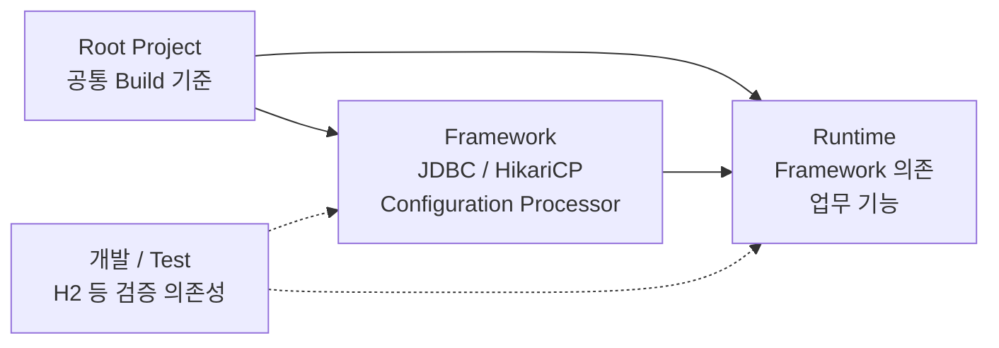

# DataSource Bean 구현과 등록

의존성을 준비하고 접속 프로퍼티, DataSource, 트랜잭션 관리자를 Spring Bean으로 등록한다.

1. [DataSource 구성 원칙과 외부 설정](datasource_framework_setup.md)
2. [DataSource Bean 구현과 등록](datasource_bean_setup.md)
3. [DataSource 접속 검증과 운영 기준](datasource_connection_verification.md)

## 6. DataSource 구현을 위한 의존성 추가

DataSource Framework를 구현하려면 JDBC, Connection Pool, 테스트용
Database와 Configuration Property 처리를 위한 의존성이 필요하다.

현재는 아직 Framework와 Runtime을 실제 Gradle Sub Project로 분리하기
전이므로 **현재 MicroServer 프로젝트의 Root `build.gradle`에 필요한
의존성을 추가하여 DataSource 구성을 먼저 검증한다.**

```groovy
dependencies {
    // Spring MVC 기반 Web Application
    implementation 'org.springframework.boot:spring-boot-starter-webmvc'

    // DataSource / JDBC / Transaction
    // HikariCP가 기본 Connection Pool 구현체로 함께 제공된다.
    implementation 'org.springframework.boot:spring-boot-starter-jdbc'

    // Spring Boot 사용자 정의 설정(Configuration Properties) Metadata 생성
    // @ConfigurationProperties로 정의한 microserver.datasource 등의 설정정보를
    // 빌드 시 META-INF/spring-configuration-metadata.json으로 생성한다.
    // VS Code / IDE에서 사용자 정의 YAML Property의 자동완성, 설명 및 검증을 지원한다.
    // 애플리케이션 실행 기능이 아니라 개발도구 지원을 위한 Annotation Processor이다.
    annotationProcessor 'org.springframework.boot:spring-boot-configuration-processor'

    // Lombok Annotation을 Java 소스 컴파일 시 사용할 수 있게 한다.
    // @Getter, @Setter 등의 Annotation을 코드에서 사용할 수 있게 하며,
    // Lombok은 컴파일 과정에서 코드를 생성하므로 Runtime 의존성에는 포함하지 않는다.
    compileOnly 'org.projectlombok:lombok'

    // Java 컴파일 시 Lombok Annotation Processor를 실행한다.
    // @Getter, @Setter 등의 Annotation을 분석하여 실제 Getter / Setter 코드를 생성한다.
    annotationProcessor 'org.projectlombok:lombok'

    // 테스트 소스(src/test/java)에서도 Lombok Annotation을 사용할 수 있게 한다.
    // 테스트용 클래스에서 @Getter, @Setter 등을 사용할 때 필요하다.
    testCompileOnly 'org.projectlombok:lombok'

    // 테스트 Java 소스를 컴파일할 때도 Lombok Annotation Processor를 실행한다.
    // 테스트 코드에 선언된 Lombok Annotation을 실제 코드로 생성한다.
    testAnnotationProcessor 'org.projectlombok:lombok'

    // 초기 DataSource 구성 및 접속 검증용 In-Memory Database
    runtimeOnly 'com.h2database:h2'

    // Spring MVC Test
    testImplementation 'org.springframework.boot:spring-boot-starter-webmvc-test'

    // JUnit Platform Test Runtime
    testRuntimeOnly 'org.junit.platform:junit-platform-launcher'
}
```

### 각 의존성의 역할

#### `spring-boot-starter-jdbc`

DataSource와 JDBC 기반 Database 처리를 위한 Spring Boot Starter이다.

이번 DataSource Framework에서 사용하는 주요 기능은 다음과 같다.

- `DataSource`
- JDBC 기반 Database 연결
- `DataSourceTransactionManager`
- Spring Transaction 기반
- HikariCP Connection Pool

Spring Boot JDBC Starter를 사용하면 HikariCP가 기본 Connection Pool
구현체로 포함되므로 HikariCP를 별도의 라이브러리로 추가하지 않는다.

#### `spring-boot-configuration-processor`

MicroServer에서는 Spring Boot 기본 Property가 아닌 Framework 전용
Property를 사용한다.

```yaml
microserver:
  datasource:
    framework:
    business:
```

`microserver.datasource`는 MicroServer가 정의한 사용자 Property이므로
`@ConfigurationProperties`와 Configuration Processor를 이용하여
Metadata를 생성한다.

이 Metadata를 통해 VS Code와 IDE가 MicroServer Framework의 Property
구조를 인식하고 자동완성 및 Property 검증을 지원할 수 있다.

> `annotationProcessor`는 DataSource 실행을 위한 JDBC Driver가 아니다.
> Framework에서 정의한 Configuration Property 정보를 Build 시점에
> 생성하기 위한 개발 지원 의존성이다.

#### `lombok`

Lombok은 Getter / Setter처럼 반복적으로 작성되는 Java 코드를 Annotation으로 생성하기 위해 사용한다.

DataSource Property 클래스는 외부 YAML 값을 바인딩하기 위해 여러 Property 필드의 Getter / Setter가 필요하다. 이를 직접 작성하면 설정 항목이 늘어날수록 반복 코드가 많아지므로 `@Getter`, `@Setter`를 사용하여 Property 클래스의 핵심 설정 구조가 더 잘 보이도록 한다.

Gradle에서는 Lombok Annotation을 소스에서 참조하기 위한 `compileOnly`와 컴파일 과정에서 실제 코드를 생성하기 위한 `annotationProcessor`를 함께 사용한다. 테스트 코드에서 Lombok을 사용할 수 있도록 `testCompileOnly`, `testAnnotationProcessor`도 함께 구성한다.

> Lombok은 Runtime에서 Getter / Setter를 동적으로 만드는 라이브러리가 아니다.
> Java 컴파일 과정에서 Annotation Processor가 필요한 코드를 생성하므로 Runtime 의존성으로 포함하지 않는다.

#### `h2`

H2는 실제 운영 Database가 아니라 **DataSource Framework의 초기 구성과
접속을 검증하기 위한 In-Memory Database**로 사용한다.

Framework DB와 Business DB를 각각 별도의 H2 Database로 생성하여 다음
사항을 먼저 검증한다.

- 두 DataSource Bean이 정상 생성되는가
- Framework / Business DataSource가 서로 분리되는가
- 각각 독립적인 Connection을 얻을 수 있는가
- 두 TransactionManager가 정상 구성되는가

이 검증이 완료되면 H2 설정을 Oracle 등 실제 Database 접속정보로
변경한다.

### `build.gradle` 변경 후 Gradle 동기화

`build.gradle`을 저장하면 VS Code Java Extension에서 다음과 같은
메시지가 나타날 수 있다.

```text
A build file was modified.
Do you want to synchronize the Java classpath/configuration?
```

이 경우 **Yes**를 선택하여 변경된 Gradle 의존성을 Java Classpath와
프로젝트 설정에 반영한다.

### 실제 DB Driver

H2 검증 후 Oracle 등 실제 DB를 사용할 때는 해당 JDBC Driver를 프로젝트
정책에 맞게 추가한다.

Database Driver는 실제 접속 대상 DBMS가 결정되는 시점에 적용한다.

### 멀티프로젝트 전환 후 의존성 재정리

현재 Root `build.gradle`에 의존성을 추가하는 것은 **DataSource
Framework의 구조와 접속을 먼저 검증하기 위한 초기 구성**이다.

Framework와 Runtime을 Gradle Sub Project로 분리한 뒤에는 각 의존성을
실제 사용하는 모듈에 배치한다.



최종적으로는 다음 원칙으로 의존성을 다시 검토한다.

- Framework 구현에 필요한 기술 의존성은 Framework 모듈이 관리한다.
- Runtime은 Framework를 의존하여 공통 DataSource 기능을 사용한다.
- 업무 구현에만 필요한 라이브러리는 Runtime이 관리한다.
- H2와 같은 검증용 의존성은 실제 운영 Runtime에 불필요하게 포함되지
    않도록 범위를 조정한다.
- JDBC Driver의 위치와 노출 범위는 Framework와 Runtime의 실행·배포
    구조가 확정된 후 결정한다.
- Root Project에는 모든 라이브러리를 몰아넣지 않고 공통 Build 기준과
    버전 관리 중심으로 구성한다.

!!! note "현재 단계와 최종 구조를 구분한다"
    지금은 DataSource 기능 자체를 검증하기 위해 현재 프로젝트의 `build.gradle`에 필요한 의존성을 먼저 추가한다.

    **DataSource 검증이 완료되고 실제 멀티프로젝트 구조를 구성할 때 Framework / Runtime의 책임에 맞춰 의존성을 다시 분리한다.**

---
## 7. DataSource Property 클래스 작성

Framework에 다음 클래스를 생성한다.

```text
src/main/java
└── io/github/microserverlab/microserver
    └── framework/datasource
        └── MicroServerDataSourceProperties.java
```

```java
package io.github.microserverlab.microserver.framework.datasource;

import lombok.Getter;
import lombok.Setter;

import org.springframework.boot.context.properties.ConfigurationProperties;

@Getter
@ConfigurationProperties(prefix = "microserver.datasource")
public class MicroServerDataSourceProperties {

    private final DataSourceProperty framework = new DataSourceProperty();
    private final DataSourceProperty business = new DataSourceProperty();

    @Getter
    @Setter
    public static class DataSourceProperty {

        private String driverClassName;
        private String jdbcUrl;
        private String username;
        private String password;
        private int maximumPoolSize = 10;
        private int minimumIdle = 1;
    }
}
```

이 클래스는 외부 YAML의 `microserver.datasource` 설정을 Java 객체로 바인딩하여 Framework의 DataSource 생성 코드가 사용하게 한다.

최상위 `framework`, `business` 객체는 생성 후 교체하지 않으므로 `final`로 유지하고 `@Getter`만 적용한다. 실제 YAML 값이 바인딩되는 내부 `DataSourceProperty`에는 `@Getter`, `@Setter`를 적용하여 Spring Boot가 각 설정값을 주입할 수 있게 한다.

Lombok을 사용함으로써 `driverClassName`, `jdbcUrl`, `username`, `password`, Connection Pool 설정마다 반복되는 Getter / Setter를 직접 작성하지 않아도 된다. 이 클래스에서는 `equals`, `hashCode`, `toString`까지 자동 생성하는 `@Data`보다 필요한 기능만 명시하는 `@Getter`, `@Setter`를 사용한다.

문자열 Key로 설정을 직접 읽지 않고 `@ConfigurationProperties`를 사용하는 이유는 **설정 구조를 하나의 타입으로 정의하고 IDE 자동완성 및 검증을 받을 수 있게 하기 위해서**이다.

설정 구조는 다음과 같다.

```text
microserver.datasource
├── framework
│   ├── jdbc-url
│   ├── username
│   └── ...
└── business
    ├── jdbc-url
    ├── username
    └── ...
```

---
## 8. Framework DataSource Configuration 작성

다음 클래스를 생성한다.

```text
src/main/java
└── io/github/microserverlab/microserver
    └── framework/datasource
        └── MicroServerDataSourceConfig.java
```

```java
package io.github.microserverlab.microserver.framework.datasource;

import com.zaxxer.hikari.HikariConfig;
import com.zaxxer.hikari.HikariDataSource;
import javax.sql.DataSource;

import org.springframework.beans.factory.annotation.Qualifier;
import org.springframework.boot.context.properties.EnableConfigurationProperties;
import org.springframework.context.annotation.Bean;
import org.springframework.context.annotation.Configuration;
import org.springframework.context.annotation.Primary;
import org.springframework.jdbc.datasource.DataSourceTransactionManager;
import org.springframework.transaction.PlatformTransactionManager;

@Configuration
@EnableConfigurationProperties(MicroServerDataSourceProperties.class)
public class MicroServerDataSourceConfig {

    @Bean(name = "frameworkDataSource")
    public DataSource frameworkDataSource(
            MicroServerDataSourceProperties properties) {

        return createDataSource(
                "microserver-framework-pool",
                properties.getFramework());
    }

    @Primary
    @Bean(name = "businessDataSource")
    public DataSource businessDataSource(
            MicroServerDataSourceProperties properties) {

        return createDataSource(
                "microserver-business-pool",
                properties.getBusiness());
    }

    @Bean(name = "frameworkTransactionManager")
    public PlatformTransactionManager frameworkTransactionManager(
            @Qualifier("frameworkDataSource") DataSource dataSource) {

        return new DataSourceTransactionManager(dataSource);
    }

    @Primary
    @Bean(name = "businessTransactionManager")
    public PlatformTransactionManager businessTransactionManager(
            @Qualifier("businessDataSource") DataSource dataSource) {

        return new DataSourceTransactionManager(dataSource);
    }

    private DataSource createDataSource(
            String poolName,
            MicroServerDataSourceProperties.DataSourceProperty property) {

        HikariConfig config = new HikariConfig();

        config.setPoolName(poolName);
        config.setDriverClassName(property.getDriverClassName());
        config.setJdbcUrl(property.getJdbcUrl());
        config.setUsername(property.getUsername());
        config.setPassword(property.getPassword());
        config.setMaximumPoolSize(property.getMaximumPoolSize());
        config.setMinimumIdle(property.getMinimumIdle());

        return new HikariDataSource(config);
    }
}
```

### 왜 Business DataSource를 `@Primary`로 지정하는가

Runtime의 대부분 Database 작업은 업무 DB를 사용한다.

따라서 DataSource 또는 TransactionManager를 별도 Qualifier 없이 주입할
때 Business DataSource가 기본으로 선택되도록 한다.

Framework DB를 사용하는 Framework 기능은 다음처럼 Bean 이름을 명시한다.

```java
@Qualifier("frameworkDataSource")
```

이 기준을 사용하면 업무 개발자가 일반적인 업무 코드에서 Framework DB를
실수로 사용하는 가능성을 줄일 수 있다.

---
## 9. 현재 MicroserverApplication에서 Framework Configuration 인식

현재 프로젝트의 실제 Main Class는 다음 Package를 사용한다.

```text
io.github.microserverlab.microserver
```

Main Class는 `io.github.microserverlab.microserver.MicroserverApplication`이며, Framework DataSource 클래스는 현재 단일 프로젝트 검증 단계에서 Main Package 하위에 배치한다.

```text
src/main/java/
└── io/github/microserverlab/microserver/
    ├── MicroserverApplication.java
    └── framework/
        └── datasource/
            ├── MicroServerDataSourceProperties.java
            └── MicroServerDataSourceConfig.java
```

`@SpringBootApplication`은 선언된 Package를 기준으로 하위 Package를 Component Scan한다. 따라서 `framework.datasource`가 `io.github.microserverlab.microserver` 하위에 있으면 `MicroServerDataSourceConfig`의 `@Configuration`도 자동으로 검색된다.

현재 Main Class는 별도의 `@Import`를 추가하지 않고 그대로 사용한다.

```java
package io.github.microserverlab.microserver;

import org.springframework.boot.SpringApplication;
import org.springframework.boot.autoconfigure.SpringBootApplication;

@SpringBootApplication
public class MicroserverApplication {

    public static void main(String[] args) {
        SpringApplication.run(MicroserverApplication.class, args);
    }
}
```

즉 현재 단계에서는 가이드 예제를 위해 별도의 `RuntimeApplication`을 만들지 않는다. 실제 멀티프로젝트 전환 후 Framework가 별도 Module/JAR로 분리되면 Component Scan 범위와 Spring Boot Auto Configuration 적용 방식을 다시 설계한다.

---
