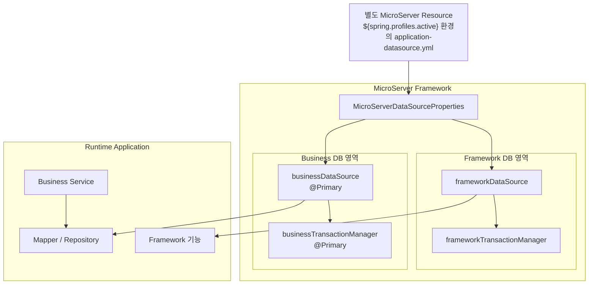

# DataSource 접속 검증과 운영 기준

Framework DB와 Business DB의 접속을 검증하고 트랜잭션 및 실제 DB 전환 기준을 확인한다.

1. [DataSource 구성 원칙과 외부 설정](datasource_framework_setup.md)
2. [DataSource Bean 구현과 등록](datasource_bean_setup.md)
3. [DataSource 접속 검증과 운영 기준](datasource_connection_verification.md)

## 10. Framework DataSource 접속 테스트

Framework DB 접속을 검증하는 테스트를 `src/test/java/io/github/microserverlab/microserver/datasource/` 하위에 작성한다.

이 테스트는 단순히 H2가 실행되는지만 확인하는 것이 아니라 **외부 설정 → Property 바인딩 → Framework DataSource Bean 생성 → 실제 Connection 획득**까지 전체 연결 경로를 검증한다.

```java
package io.github.microserverlab.microserver.datasource;

import static org.assertj.core.api.Assertions.assertThat;

import java.sql.Connection;
import javax.sql.DataSource;

import org.junit.jupiter.api.Test;
import org.springframework.beans.factory.annotation.Autowired;
import org.springframework.beans.factory.annotation.Qualifier;
import org.springframework.boot.test.context.SpringBootTest;

@SpringBootTest
class FrameworkDataSourceConnectionTest {

    @Autowired
    @Qualifier("frameworkDataSource")
    private DataSource dataSource;

    @Test
    void frameworkDataSourceConnectionTest() throws Exception {
        try (Connection connection = dataSource.getConnection()) {
            assertThat(connection.isClosed()).isFalse();
            System.out.println(
                    "Framework DB URL = "
                    + connection.getMetaData().getURL());
        }
    }
}
```

### 10.1 실행 전 확인

1. 앞 절의 Gradle 의존성, Property 클래스, DataSource Configuration을 저장하고 Gradle 동기화를 완료한다.
2. [5절](datasource_framework_setup.md#5-spring-profile)의 외부 설정 Import 규칙이 적용되어 있는지 확인한다. `local` Profile로 실행하면 외부 Resource의 `config/application-context/local/application-datasource.yml`을 읽어야 한다.
3. 해당 외부 YAML에 **Framework / Business 두 DataSource 설정**이 모두 있는지 확인한다. 테스트가 Framework DB만 사용해도 Spring 컨텍스트를 시작할 때 두 DataSource Bean을 모두 생성하기 때문이다.
4. 현재 예제의 `jdbc:h2:mem:...`는 테스트 JVM 안에서 생성되는 In-Memory DB이므로 별도의 H2 서버를 실행하지 않는다. 외부 DB로 변경했다면 해당 서버에 접속할 수 있어야 한다.

아래 실행 예는 현재 개발환경의 다음 경로를 기준으로 한다. 다른 PC에서는 실제 경로로 변경한다.

| 구분 | 경로 |
| --- | --- |
| Java 프로젝트 | `/Users/jangkwankim/local-microserver/workspace/microserver` |
| 외부 Resource Root | `/Users/jangkwankim/local-microserver/workspace/microserver-resource` |
| Local DB 설정 | `microserver-resource/config/application-context/local/application-datasource.yml` |

### 10.2 VS Code에서 테스트 실행 설정

**애플리케이션 실행용 `launch.json`과 JUnit 테스트 실행 설정은 별개이다.** `launch.json`에 Profile이나 Resource 경로를 지정했더라도 테스트 실행에 동일하게 전달된다고 가정하지 않는다.

VS Code에서 열어 둔 Workspace의 `.vscode/settings.json`에 다음 항목을 추가한다. 현재 개발환경에서 `workspace` 폴더를 열었다면 `/Users/jangkwankim/local-microserver/workspace/.vscode/settings.json`이다.

기존 설정은 유지하고 최상위 JSON 객체 안에 `java.test.config`와 `java.test.defaultConfig`를 추가한다. 아래 예시의 절대경로는 외부 Resource Root를 가리킨다.

```json
{
  "java.test.config": [
    {
      "name": "microserver-local",
      "vmArgs": [
        "-Dspring.profiles.active=local",
        "-Dmicroserver.resource-dir=/Users/jangkwankim/local-microserver/workspace/microserver-resource"
      ]
    }
  ],
  "java.test.defaultConfig": "microserver-local"
}
```

- `java.test.config`: Test Runner for Java가 테스트 JVM을 실행할 때 사용할 설정이다.
- `vmArgs`: 테스트 JVM에 전달할 옵션이다. `-D`로 지정한 값은 Spring이 시스템 Property로 읽는다.
- `spring.profiles.active=local`: Local 환경을 선택한다.
- `microserver.resource-dir`: 외부 Resource Root를 지정한다. `config`나 YAML 파일 자체의 경로가 아니다.
- `java.test.defaultConfig`: 여러 테스트 실행 설정 중 기본으로 사용할 설정 이름이다.

설정은 [VS Code Java 테스트 공식 문서](https://code.visualstudio.com/docs/java/java-testing)의 `java.test.config` 기준이다.

### 10.3 VS Code에서 실행 및 결과 확인

1. `FrameworkDataSourceConnectionTest.java`를 열고 저장한다.
2. 클래스 또는 `@Test` 메서드 옆의 초록색 실행 아이콘을 누른다. `Run Test` 링크가 표시되는 환경에서는 해당 링크를 눌러도 된다.
3. 또는 왼쪽 **Testing**(플라스크 아이콘)을 열고 `FrameworkDataSourceConnectionTest`를 찾아 실행한다.
4. 테스트가 끝나면 Testing 화면에서 성공 표시를 확인한다. 실패하면 해당 테스트를 선택하여 오류와 예외 원인을 확인한다.
5. 해당 테스트의 출력 화면에서 `Framework DB URL`을 확인한다. 현재 로컬 Java 파일처럼 출력 문구를 `DB URL`로 작성했다면 그 문구로 표시된다.

실행 아이콘이나 테스트가 보이지 않으면 **Test Runner for Java** 확장이 설치·활성화되어 있는지, Java 프로젝트 로딩과 Gradle 동기화가 끝났는지 확인한다. 이 클래스는 `main()` 메서드가 아닌 JUnit 테스트이므로 테스트 실행 기능으로 실행한다.

### 10.4 터미널에서 특정 테스트만 실행

VS Code 테스트 실행과 별도로 Gradle Wrapper로도 실행할 수 있다. 터미널에서 `build.gradle`과 `gradlew`가 있는 Java 프로젝트 디렉터리로 이동한다.

```bash
cd /Users/jangkwankim/local-microserver/workspace/microserver
```

다음 명령은 Local Profile과 외부 Resource Root를 환경변수로 전달하고, Framework 테스트 클래스만 선택하여 실행한다. `SPRING_APPLICATION_JSON`은 Spring Boot가 읽는 설정 전달 방식이며, Gradle이 시작하는 테스트 프로세스에도 환경변수가 전달된다.

```bash
SPRING_APPLICATION_JSON='{"spring":{"profiles":{"active":"local"}},"microserver":{"resource-dir":"/Users/jangkwankim/local-microserver/workspace/microserver-resource"}}' \
  bash ./gradlew test \
  --tests 'io.github.microserverlab.microserver.datasource.FrameworkDataSourceConnectionTest' \
  --rerun-tasks --info
```

- `bash ./gradlew`: Wrapper에 실행 권한이 없는 환경에서도 실행할 수 있다.
- `--tests`: 실행할 테스트 클래스를 지정한다. 메서드명이 `connectionTest`이든 가이드의 `frameworkDataSourceConnectionTest`이든 해당 클래스의 테스트를 실행한다.
- `--rerun-tasks`: 이전 결과가 있어도 테스트를 다시 수행한다.
- `--info`: 테스트의 표준 출력과 상세 실행 정보를 확인한다.

VS Code의 `java.test.config`는 위 터미널 실행에는 적용되지 않으므로 환경 설정을 별도로 전달한다. 현재 프로젝트의 Java Toolchain 기준인 **JDK 25**가 사용 가능해야 하며, 첫 실행에서는 Gradle 및 의존성 다운로드가 필요할 수 있다.

테스트 성공 시 터미널에서 `BUILD SUCCESSFUL`을 확인하고, 상세 결과는 프로젝트의 `build/reports/tests/test/index.html`을 브라우저로 열어 확인한다. `BUILD SUCCESSFUL`과 함께 테스트가 실제 실행되었고 실패가 없는지도 확인한다.

특정 테스트 선택과 보고서는 [Gradle Java 테스트 공식 문서](https://docs.gradle.org/current/userguide/java_testing.html)를 참고한다.

### 10.5 실행 오류 확인

| 증상 | 확인할 내용 |
| --- | --- |
| Profile 또는 Resource 경로 Placeholder 해석 실패 | `spring.profiles.active`, `microserver.resource-dir`이 **테스트 실행 환경**에 전달됐는지 확인한다. |
| 외부 설정파일을 찾지 못함 | Resource Root 아래에 `config/application-context/local/application-datasource.yml`이 존재하는지 확인한다. |
| `jdbcUrl` 또는 Driver 관련 오류 | 외부 YAML의 `microserver.datasource.framework`와 `business` 설정, JDBC 의존성 및 Gradle 동기화를 확인한다. |
| `No tests found` 또는 테스트 탐색 실패 | 테스트 경로·Package·클래스명, `@Test` import가 `org.junit.jupiter.api.Test`인지, `useJUnitPlatform()` 설정을 확인한다. |
| Java Toolchain 관련 오류 | 프로젝트에서 요구하는 JDK 25 설치 및 Gradle의 JDK 인식 여부를 확인한다. |

### 10.6 정상 결과 확인

정상 결과 예:

```text
Framework DB URL = jdbc:h2:mem:frameworkdb
```

---
## 11. Business DataSource 접속 테스트

Business DB도 `src/test/java/io/github/microserverlab/microserver/` 하위에서 독립적으로 검증한다.

별도 테스트가 필요한 이유는 두 DataSource Bean이 실수로 같은 설정이나 같은 Database를 바라보는 구성 오류를 확인하기 위해서이다.

```java
package io.github.microserverlab.microserver.datasource;

import static org.assertj.core.api.Assertions.assertThat;

import java.sql.Connection;
import javax.sql.DataSource;

import org.junit.jupiter.api.Test;
import org.springframework.beans.factory.annotation.Autowired;
import org.springframework.beans.factory.annotation.Qualifier;
import org.springframework.boot.test.context.SpringBootTest;

@SpringBootTest
class BusinessDataSourceConnectionTest {

    @Autowired
    @Qualifier("businessDataSource")
    private DataSource dataSource;

    @Test
    void businessDataSourceConnectionTest() throws Exception {
        try (Connection connection = dataSource.getConnection()) {
            assertThat(connection.isClosed()).isFalse();
            System.out.println(
                    "Business DB URL = "
                    + connection.getMetaData().getURL());
        }
    }
}
```

정상 결과 예:

```text
Business DB URL = jdbc:h2:mem:businessdb
```

두 테스트가 각각 다른 URL을 출력해야 한다.

---
## 12. Application 기동 시 두 DataSource 동시 확인

테스트뿐 아니라 실제 Runtime 기동 시 두 DataSource가 정상 생성되는지도
확인한다.

임시 검증용 `ApplicationRunner`는 `io.github.microserverlab.microserver.verify` Package에 작성한다.

```java
package io.github.microserverlab.microserver.verify;

import java.sql.Connection;
import javax.sql.DataSource;

import org.springframework.beans.factory.annotation.Qualifier;
import org.springframework.boot.ApplicationArguments;
import org.springframework.boot.ApplicationRunner;
import org.springframework.stereotype.Component;

@Component
public class DataSourceConnectionVerifier implements ApplicationRunner {

    private final DataSource frameworkDataSource;
    private final DataSource businessDataSource;

    public DataSourceConnectionVerifier(
            @Qualifier("frameworkDataSource") DataSource frameworkDataSource,
            @Qualifier("businessDataSource") DataSource businessDataSource) {

        this.frameworkDataSource = frameworkDataSource;
        this.businessDataSource = businessDataSource;
    }

    @Override
    public void run(ApplicationArguments args) throws Exception {
        verify("Framework", frameworkDataSource);
        verify("Business", businessDataSource);
    }

    private void verify(String name, DataSource dataSource) throws Exception {
        try (Connection connection = dataSource.getConnection()) {
            System.out.println(
                    "[DataSource OK] " + name
                    + " : " + connection.getMetaData().getURL());
        }
    }
}
```

Application 기동 로그에서 다음과 같이 확인한다.

```text
[DataSource OK] Framework : jdbc:h2:mem:frameworkdb
[DataSource OK] Business  : jdbc:h2:mem:businessdb
```

접속 검증이 끝나면 이 임시 클래스는 제거한다. 운영용 Health Check는 이후
Actuator와 Framework 관리기능을 설계할 때 별도로 구성한다.

---
## 13. Transaction 사용 기준

두 개의 TransactionManager가 존재하므로 어느 DB의 Transaction인지
명확해야 한다.

### 일반 업무 Transaction

Business TransactionManager를 `@Primary`로 지정했으므로 일반적인
업무에서는 다음처럼 사용할 수 있다.

```java
@Transactional
public void processBusiness() {
    // Business DB 처리
}
```

### Framework DB Transaction

Framework DB를 사용하는 기능에서는 TransactionManager를 명시한다.

```java
@Transactional(transactionManager = "frameworkTransactionManager")
public void updateFrameworkData() {
    // Framework DB 처리
}
```

### 주의

Framework DB와 Business DB를 하나의 메서드에서 동시에 변경한다고 해서 두
Database의 Transaction이 자동으로 하나의 Transaction이 되는 것은 아니다.

두 DB를 하나의 원자적 Transaction으로 묶어야 하는 요구사항이 생기면 분산
Transaction 또는 업무 보상 방식 등을 별도로 설계한다.

초기 Framework에서는 두 DataSource의 Transaction을 독립적으로 관리한다.

---
## 14. 실제 DB로 변경

H2 검증이 완료되면 각 실행환경의 `application-datasource.yml` 접속정보를 실제 환경에 맞게 변경한다.

예시:

```yaml
microserver:
  datasource:

    framework:
      driver-class-name: oracle.jdbc.OracleDriver
      jdbc-url: jdbc:oracle:thin:@//framework-db-host:1521/SERVICE
      username: ${FRAMEWORK_DB_USERNAME}
      password: ${FRAMEWORK_DB_PASSWORD}
      maximum-pool-size: 10
      minimum-idle: 2

    business:
      driver-class-name: oracle.jdbc.OracleDriver
      jdbc-url: jdbc:oracle:thin:@//business-db-host:1521/SERVICE
      username: ${BUSINESS_DB_USERNAME}
      password: ${BUSINESS_DB_PASSWORD}
      maximum-pool-size: 30
      minimum-idle: 5
```

외부 Resource로 분리해도 Password를 YAML에 평문으로 저장하면 해당 파일의 읽기 권한을 가진 사용자는 값을 확인할 수 있다.

따라서 실제 환경에서는 `${FRAMEWORK_DB_PASSWORD}`, `${BUSINESS_DB_PASSWORD}`처럼 환경변수 또는 향후 Secret 관리 기능으로 값을 주입한다.

외부 Resource 분리는 **Source/JAR과 환경설정을 분리하는 구조적 장치**이고, Secret 보호는 **접근권한과 Secret 전달방식을 별도로 설계해야 하는 보안 영역**이다.

---
## 15. 최종 구조



이 구조에서 Framework는 **두 DataSource를 생성하고 사용할 수 있는 기술
기반**을 제공한다.

Runtime은 Framework 내부의 DataSource 생성 방법을 알 필요가 없으며, 업무
Database 접근에 필요한 Mapper / Repository와 업무 Transaction 범위에
집중한다.

---
## 16. 다음 단계

두 DataSource의 생성과 접속 검증이 완료되면 Data Access 계층을 확장한다.

MyBatis 공통기능을 Framework에 둔다는 것은 업무 Mapper와 SQL을 Framework로 이동한다는 뜻이 아니다. **SqlSessionFactory, SqlSessionTemplate, Mapper Scan 기준 등 공통 기술 기반은 Framework가 제공하고 실제 Mapper Interface / XML / SQL은 Runtime이 소유**하는 방향으로 구성한다.

다음 순서로 확장한다.

1. Business DataSource와 MyBatis 연결
2. Runtime Mapper Interface / Mapper XML 작성
3. Business `SqlSessionFactory` / `SqlSessionTemplate` 구성
4. Framework DB 전용 MyBatis 구성이 필요한지 검토
5. Transaction 동작 검증
6. DataSource Health Check 구성
7. Framework Auto Configuration 전환
8. Gradle 멀티프로젝트 전환 후 Framework / Runtime 의존성 재배치
9. H2, JDBC Driver 등 개발·테스트·운영 의존성 범위 최종 정리

DataSource 기반이 검증되기 전에는 MyBatis Mapper 구조를 먼저 확장하지
않는다. 먼저 **두 DataSource가 Framework에서 생성되고 Runtime에서
정확하게 구분되어 사용되는 것**을 확인한다.
