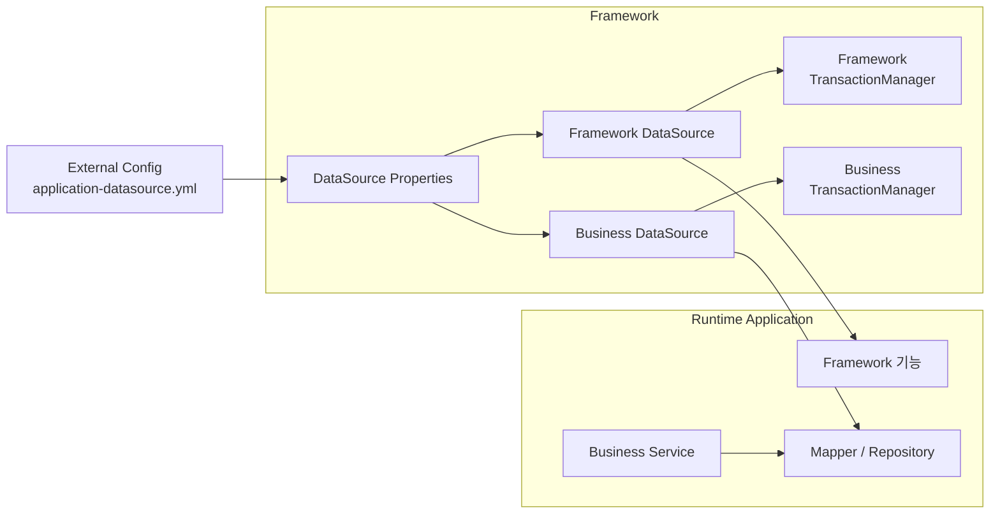
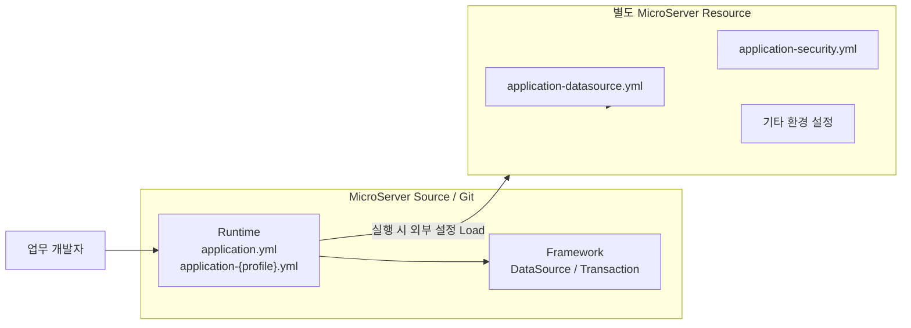
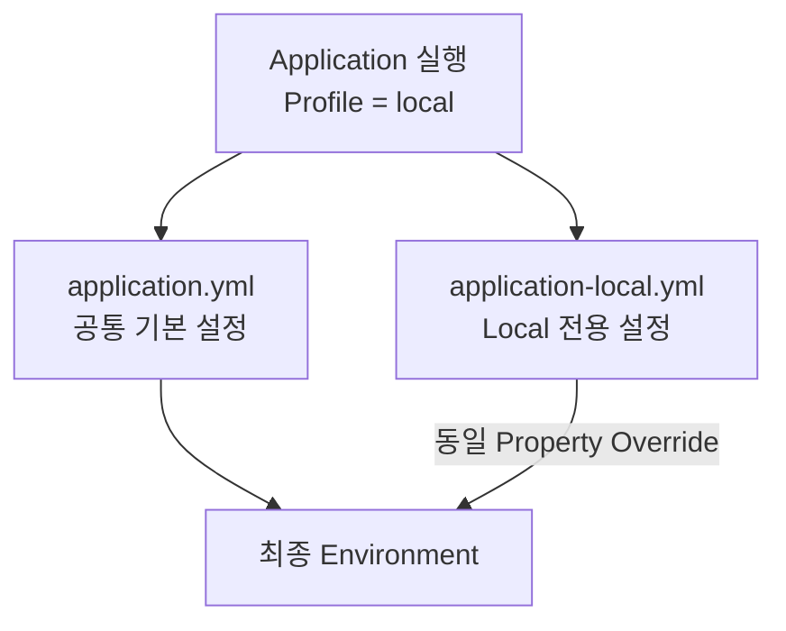
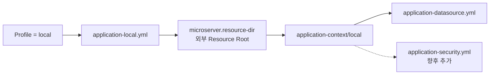
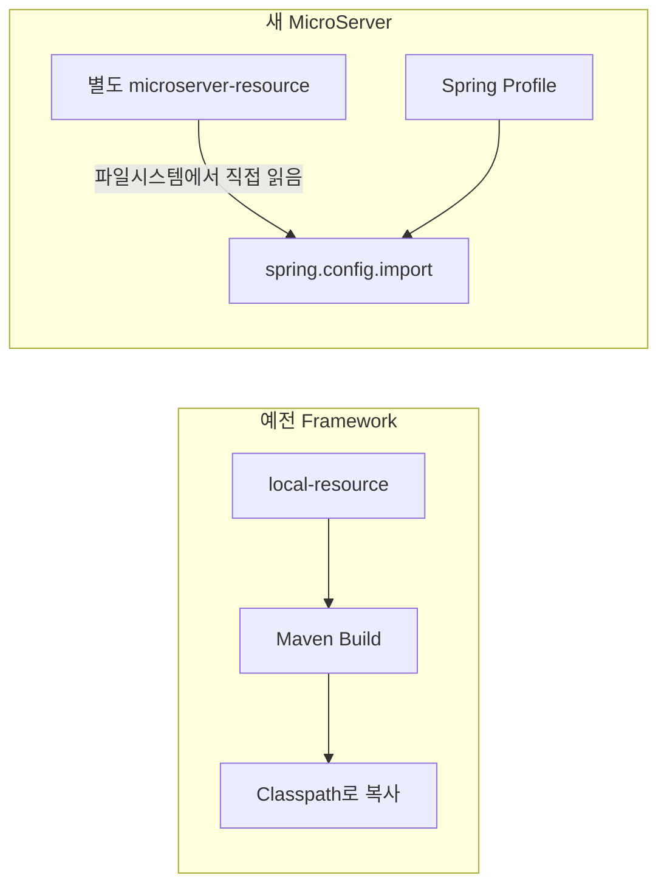
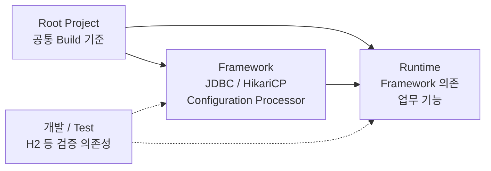
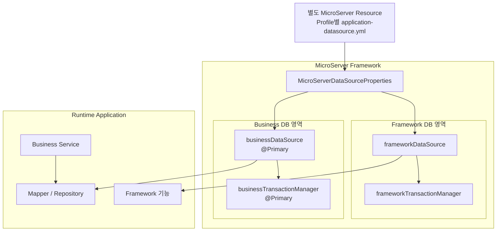

# DataSource Framework 구성 및 접속 검증

## 1. 구성 목표

MicroServer Framework에서 Database 연결을 공통 기능으로 제공한다.

기본적으로 다음 두 DataSource를 구성한다.

- **Framework DataSource**: Framework 자체 기능에서 사용하는 Database
- **Business DataSource**: Runtime Application의 도메인 업무에서
    사용하는 Database

Runtime 개발자는 DataSource와 Connection Pool을 직접 생성하지 않고
Framework가 제공하는 Bean을 사용한다.



---
## 2. 이번 구성의 핵심 원칙

DataSource는 Runtime의 모든 Database 접근이 시작되는 기반 기능이다. 각 업무 프로젝트가 DataSource 생성 방식, Connection Pool, Bean 이름, TransactionManager 구성을 각각 구현하면 프로젝트마다 설정 방식이 달라지고 운영 기준도 분산된다.

따라서 **Database 연결을 만드는 기술적인 책임은 Framework가 담당하고, 어떤 Database에 접속할 것인지에 대한 환경별 값과 실제 업무 SQL은 Runtime 및 실행환경의 책임으로 분리한다.**

### Framework가 담당하는 영역

Framework는 DataSource Property 구조, HikariCP 기반 DataSource 생성, Framework / Business DataSource Bean, Bean 이름과 `@Primary` 기준, TransactionManager, 향후 MyBatis / JPA 연결 기반을 표준화한다.

이 기능들을 Framework에 두는 이유는 **업무 개발자가 Database 연결 인프라를 프로젝트마다 다시 구성하지 않도록 하기 위해서**이다. Runtime 개발자는 Framework가 HikariCP를 어떻게 생성하고 TransactionManager를 어떻게 등록하는지 몰라도 업무 개발이 가능해야 한다.

### Runtime이 담당하는 영역

Runtime은 실제 도메인 업무를 구현하므로 **업무 Mapper / Repository, Mapper XML, 업무 SQL, Service의 Transaction 범위**를 담당한다.

특히 Mapper Interface, Mapper XML, 업무 SQL은 Framework가 아니라 Runtime에 둔다. SQL은 특정 업무 테이블과 도메인 규칙에 종속되므로 공통 Framework에 포함하면 Framework와 업무가 강하게 결합되기 때문이다.

반면 Runtime은 `DataSource` 자체를 생성하거나 HikariCP를 직접 구성하지 않는다. Framework가 제공하는 Business DataSource와 Transaction 기반 위에서 업무 Data Access를 구현한다.

### Framework DataSource와 Business DataSource를 분리한다

**Framework DataSource**는 Framework 자체 기능에서 사용하는 Database 연결이고, **Business DataSource**는 Runtime의 실제 도메인 업무에서 사용하는 Database 연결이다.

두 DataSource를 명시적으로 분리하면 Framework 기능이 업무 Database에 불필요하게 의존하는 것을 줄이고, Connection Pool과 Transaction 정책도 독립적으로 관리할 수 있다.

### 접속정보는 Framework와 Runtime 소스에서 분리한다

DB URL, 계정, Password 같은 값은 환경마다 다르고 민감정보를 포함할 수 있다.

따라서 Framework JAR이나 Runtime 소스에 직접 작성하지 않고 **실행환경의 외부 Resource에서 제공**한다.

여기서 외부 설정은 단순히 Classpath 밖이라는 의미만으로 끝나지 않는다. MicroServer에서는 가능하면 **업무 개발자가 사용하는 Git Project와 실제 환경별 설정파일의 저장 위치 자체를 분리**하여 관리한다.

---
## 3. 권장 프로젝트 및 외부 Resource 구조

### 3.1 Classpath 외부와 개발 프로젝트 외부는 다르다

`file:` 방식으로 읽는 `./config/application-context/local/application-datasource.yml`은 **Classpath 외부 설정파일**이다.

하지만 `config` 디렉터리가 업무 개발자가 Clone하는 Git Project 안에 있으면 개발자는 파일 내용을 볼 수 있다.

| 구분 | 의미 |
| --- | --- |
| Classpath 외부 | 설정파일이 Runtime JAR/Classpath에 포함되지 않음 |
| 개발 프로젝트 외부 | 설정파일 자체가 업무 개발자의 Source/Git Project와 분리됨 |

MicroServer는 두 번째까지 포함하여 **실제 DB 접속정보와 보안 관련 환경설정을 Application Source와 별도의 Resource 영역에서 관리**하는 것을 권장한다.

### 3.2 권장 구조

```text
[업무 개발자가 사용하는 MicroServer Project]

microserver/
├── framework/
├── runtime/
│   └── src/main/resources/
│       ├── application.yml
│       ├── application-local.yml
│       ├── application-dev.yml
│       └── application-prod.yml
├── build.gradle
└── settings.gradle


[별도로 관리하는 MicroServer Resource]

microserver-resource/
└── config/
    └── application-context/
        ├── local/
        │   ├── application-datasource.yml
        │   ├── application-security.yml
        │   └── ...
        ├── dev/
        │   ├── application-datasource.yml
        │   ├── application-security.yml
        │   └── ...
        └── prod/
            ├── application-datasource.yml
            ├── application-security.yml
            └── ...
```



멀티프로젝트 전환 전 현재 단일 프로젝트에서 DataSource를 검증할 때도 같은 원칙을 적용할 수 있다. Java 코드는 현재 프로젝트에 두고 외부 Resource만 별도 위치에서 관리한다.

### 3.3 환경별 설정은 동일한 한 벌로 관리한다

Local / Dev / Prod 환경마다 파일 종류를 다르게 만들지 않고 동일한 이름과 책임을 유지한다.

```text
local/
├── application-datasource.yml
├── application-security.yml
└── ...

dev/
├── application-datasource.yml
├── application-security.yml
└── ...

prod/
├── application-datasource.yml
├── application-security.yml
└── ...
```

환경이 달라질 때 바뀌는 것은 파일의 역할이 아니라 **파일 안의 실제 설정값**이다. 향후 Logging, JWT, SSL, Kafka 등의 설정도 같은 원칙으로 확장한다.

### 3.4 외부 Resource 분리의 목적과 한계

외부 Resource를 분리하면 DB URL과 환경별 시스템 주소가 Source/JAR에 포함되는 것을 막고, 업무 Git Repository와 운영 설정을 분리할 수 있다. 또한 동일한 Application Build 결과물을 환경별 설정만 바꾸어 실행할 수 있다.

다만 **외부 파일로 분리했다고 해서 보안이 완성되는 것은 아니다.** 해당 서버나 Resource 디렉터리에 읽기 권한이 있는 사용자는 파일을 볼 수 있다.

따라서 운영환경에서는 OS 파일 권한, 배포 계정 권한, 환경변수 또는 별도의 Secret 관리방식을 함께 적용해야 한다. Password 같은 Secret은 가능하면 YAML에 평문으로 저장하지 않는다.

---

## 4. 외부 DataSource 설정파일 작성

외부 Resource Root는 Application Source Project 밖의 별도 위치를 사용한다.

예:

```text
/opt/microserver-resource
```

macOS나 개발 PC에서는 실제 사용 가능한 별도 디렉터리로 변경하면 된다. 중요한 것은 특정 절대경로가 아니라 **Source Project와 Resource Root의 분리**이다.

Local DataSource 설정파일:

```text
${microserver.resource-dir}/config/application-context/local/application-datasource.yml
```

```yaml
microserver:
  datasource:

    framework:
      driver-class-name: org.h2.Driver
      jdbc-url: jdbc:h2:mem:frameworkdb;DB_CLOSE_DELAY=-1
      username: sa
      password:
      maximum-pool-size: 5
      minimum-idle: 1

    business:
      driver-class-name: org.h2.Driver
      jdbc-url: jdbc:h2:mem:businessdb;DB_CLOSE_DELAY=-1
      username: sa
      password:
      maximum-pool-size: 10
      minimum-idle: 1
```

첫 검증은 Oracle 등 실제 외부 DB보다 H2를 사용한다. Framework 설정 문제와 네트워크, DB 계정, 방화벽 같은 외부 요인을 분리해서 확인하기 위해서다.

Framework / Business를 서로 다른 H2 Database로 구성하여 **두 DataSource가 실제로 독립된 설정과 Connection Pool로 생성되는지** 검증한다.

!!! note "설정 Prefix"
    `spring.datasource` 대신 `microserver.datasource`를 사용한다.

    Spring Boot 기본 단일 DataSource 자동설정과 구분하고, MicroServer Framework가 Framework / Business 두 DataSource를 명시적으로 생성하고 관리하기 위한 것이다.

---

## 5. Spring Profile과 외부 설정 연결

### 5.1 `application.properties`를 `application.yml`로 전환

현재 Spring Initializr 프로젝트의 기본 설정파일은 `src/main/resources/application.properties`이다.

```properties
spring.application.name=microserver
```

Spring Boot는 Properties와 YAML을 모두 지원한다. YAML 전환은 외부 YAML을 읽기 위한 필수조건이 아니라 **MicroServer의 설정 관리 기준**이다.

DataSource, Security, MyBatis, Logging 등 계층적인 Framework 설정이 늘어날 것을 고려하여 다음처럼 변경한다.

```yaml
spring:
  application:
    name: microserver
```

### 5.2 Spring Profile에 따른 로딩과 Override

다음 파일이 존재한다고 가정한다.

```text
application.yml
application-local.yml
application-dev.yml
application-prod.yml
```

활성 Profile이 `local`이면 Spring Boot는 `application.yml`과 `application-local.yml`을 함께 적용한다.

```text
1. application.yml
   └── 모든 환경의 공통 기본 설정

2. application-local.yml
   └── local 환경 전용 설정
```

`application-local.yml`이 `application.yml`을 대체하는 것이 아니다. **기본 설정 위에 Profile 전용 설정이 추가 적용**되고, 동일한 Property가 있으면 Profile 전용 값이 공통값을 Override한다.



`local`만 활성화되어 있다면 `application-dev.yml`, `application-prod.yml`은 적용되지 않는다.

### 5.3 Profile 파일은 외부 설정의 위치를 연결한다

`application-local.yml`에는 DB URL, 계정, Password 같은 실제 환경값을 넣지 않는다.

Profile 파일은 **현재 환경에서 사용할 외부 설정 한 벌의 위치를 연결**한다.

```yaml
spring:
  config:
    import:
      - file:${microserver.resource-dir}/config/application-context/local/application-datasource.yml
```



Runtime은 외부 설정의 **위치와 종류**만 알고 실제 환경별 값은 별도 Resource 영역이 소유한다.

### 5.4 Resource Root 지정

예를 들어 외부 Resource가 `/opt/microserver-resource`에 있다면 실행환경에서 다음 값을 제공한다.

```text
microserver.resource-dir=/opt/microserver-resource
```

JAR 실행 예:

```bash
java \
  -Dmicroserver.resource-dir=/opt/microserver-resource \
  -jar runtime.jar \
  --spring.profiles.active=local
```

개발 PC와 운영서버의 실제 Resource Root는 달라도 된다. Application은 `${microserver.resource-dir}`만 참조하므로 Source 수정 없이 실행환경에서 위치를 결정할 수 있다.

!!! note "Resource Root와 Secret"
    `microserver.resource-dir`은 외부 Resource의 **위치**를 전달하는 값이다.

    DB Password 같은 Secret 자체를 이 값에 넣는 것이 아니다. Secret은 환경변수나 별도 Secret 관리기능을 통해 외부 설정파일에서 참조하도록 구성할 수 있다.

### 5.5 환경별 Profile과 설정 한 벌

```text
application-local.yml
    → ${microserver.resource-dir}/config/application-context/local/

application-dev.yml
    → ${microserver.resource-dir}/config/application-context/dev/

application-prod.yml
    → ${microserver.resource-dir}/config/application-context/prod/
```

예를 들어 `application-dev.yml`은 Dev Resource를 연결한다.

```yaml
spring:
  config:
    import:
      - file:${microserver.resource-dir}/config/application-context/dev/application-datasource.yml
```

Security가 추가되면 같은 환경의 설정을 함께 연결한다.

```yaml
spring:
  config:
    import:
      - file:${microserver.resource-dir}/config/application-context/local/application-datasource.yml
      - file:${microserver.resource-dir}/config/application-context/local/application-security.yml
```

### 5.6 `${spring.profiles.active}`를 경로에 사용할지 여부

다음처럼 활성 Profile을 경로에 직접 사용할 수도 있다.

```yaml
spring:
  config:
    import:
      - file:${microserver.resource-dir}/config/application-context/${spring.profiles.active}/application-datasource.yml
```

반복을 줄일 수 있지만 복수 Profile 등으로 구조가 확장되면 경로 의미가 불명확해질 수 있다.

따라서 초기에는 **각 `application-{profile}.yml`이 대응하는 환경 디렉터리를 명시적으로 연결**하고, 구조가 충분히 검증된 뒤 공통화 여부를 판단한다.

### 5.7 `optional:` 사용 기준

초기 경로 검증 중에는 다음처럼 사용할 수 있다.

```yaml
spring:
  config:
    import:
      - optional:file:${microserver.resource-dir}/config/application-context/local/application-datasource.yml
```

하지만 DataSource 설정은 Runtime 실행에 필요한 핵심 설정이므로 구성이 안정화되면 `optional:`을 제거하여 설정 누락을 기동 시점에 발견하도록 한다.

### 5.8 예전 방식과 이번 방식

예전 Framework도 Spring Profile로 환경을 선택하고 환경별 외부 설정 한 벌을 관리했다. 이 설계 원칙은 유지한다.

달라지는 것은 외부 Resource를 Build 과정에서 Classpath로 복사하지 않는다는 점이다.



새 구조에서는 외부 Resource를 끝까지 외부에 유지하고 Spring Boot의 Externalized Configuration으로 실행 시 직접 읽는다.

이를 통해 **환경별 설정 분리라는 기존 장점은 유지하면서 Classpath 복사 Build 작업을 제거하고, Source Repository와 실제 환경 Resource의 저장 위치를 분리**한다.

---

## 6. DataSource 구현을 위한 의존성 추가

DataSource Framework를 구현하려면 JDBC, Connection Pool, 테스트용
Database와 Configuration Property 처리를 위한 의존성이 필요하다.

현재는 아직 Framework와 Runtime을 실제 Gradle Sub Project로 분리하기
전이므로 **현재 MicroServer 프로젝트의 Root `build.gradle`에 필요한
의존성을 추가하여 DataSource 구성을 먼저 검증한다.**

```groovy
dependencies {
    // Spring MVC 기반 Web Application
    implementation 'org.springframework.boot:spring-boot-starter-webmvc'

    // DataSource / JDBC / Transaction
    // HikariCP가 기본 Connection Pool 구현체로 함께 제공된다.
    implementation 'org.springframework.boot:spring-boot-starter-jdbc'

    // Spring Boot 사용자 정의 설정(Configuration Properties) Metadata 생성
    // @ConfigurationProperties로 정의한 microserver.datasource 등의 설정정보를
    // 빌드 시 META-INF/spring-configuration-metadata.json으로 생성한다.
    // VS Code / IDE에서 사용자 정의 YAML Property의 자동완성, 설명 및 검증을 지원한다.
    // 애플리케이션 실행 기능이 아니라 개발도구 지원을 위한 Annotation Processor이다.
    annotationProcessor 'org.springframework.boot:spring-boot-configuration-processor'

    // 초기 DataSource 구성 및 접속 검증용 In-Memory Database
    runtimeOnly 'com.h2database:h2'

    // Spring MVC Test
    testImplementation 'org.springframework.boot:spring-boot-starter-webmvc-test'

    // JUnit Platform Test Runtime
    testRuntimeOnly 'org.junit.platform:junit-platform-launcher'
}
```

### 각 의존성의 역할

#### `spring-boot-starter-jdbc`

DataSource와 JDBC 기반 Database 처리를 위한 Spring Boot Starter이다.

이번 DataSource Framework에서 사용하는 주요 기능은 다음과 같다.

- `DataSource`
- JDBC 기반 Database 연결
- `DataSourceTransactionManager`
- Spring Transaction 기반
- HikariCP Connection Pool

Spring Boot JDBC Starter를 사용하면 HikariCP가 기본 Connection Pool
구현체로 포함되므로 HikariCP를 별도의 라이브러리로 추가하지 않는다.

#### `spring-boot-configuration-processor`

MicroServer에서는 Spring Boot 기본 Property가 아닌 Framework 전용
Property를 사용한다.

```yaml
microserver:
  datasource:
    framework:
    business:
```

`microserver.datasource`는 MicroServer가 정의한 사용자 Property이므로
`@ConfigurationProperties`와 Configuration Processor를 이용하여
Metadata를 생성한다.

이 Metadata를 통해 VS Code와 IDE가 MicroServer Framework의 Property
구조를 인식하고 자동완성 및 Property 검증을 지원할 수 있다.

> `annotationProcessor`는 DataSource 실행을 위한 JDBC Driver가 아니다.
> Framework에서 정의한 Configuration Property 정보를 Build 시점에
> 생성하기 위한 개발 지원 의존성이다.

#### `h2`

H2는 실제 운영 Database가 아니라 **DataSource Framework의 초기 구성과
접속을 검증하기 위한 In-Memory Database**로 사용한다.

Framework DB와 Business DB를 각각 별도의 H2 Database로 생성하여 다음
사항을 먼저 검증한다.

- 두 DataSource Bean이 정상 생성되는가
- Framework / Business DataSource가 서로 분리되는가
- 각각 독립적인 Connection을 얻을 수 있는가
- 두 TransactionManager가 정상 구성되는가

이 검증이 완료되면 H2 설정을 Oracle 등 실제 Database 접속정보로
변경한다.

### `build.gradle` 변경 후 Gradle 동기화

`build.gradle`을 저장하면 VS Code Java Extension에서 다음과 같은
메시지가 나타날 수 있다.

```text
A build file was modified.
Do you want to synchronize the Java classpath/configuration?
```

이 경우 **Yes**를 선택하여 변경된 Gradle 의존성을 Java Classpath와
프로젝트 설정에 반영한다.

### 실제 DB Driver

H2 검증 후 Oracle 등 실제 DB를 사용할 때는 해당 JDBC Driver를 프로젝트
정책에 맞게 추가한다.

Database Driver는 실제 접속 대상 DBMS가 결정되는 시점에 적용한다.

### 멀티프로젝트 전환 후 의존성 재정리

현재 Root `build.gradle`에 의존성을 추가하는 것은 **DataSource
Framework의 구조와 접속을 먼저 검증하기 위한 초기 구성**이다.

Framework와 Runtime을 Gradle Sub Project로 분리한 뒤에는 각 의존성을
실제 사용하는 모듈에 배치한다.



최종적으로는 다음 원칙으로 의존성을 다시 검토한다.

- Framework 구현에 필요한 기술 의존성은 Framework 모듈이 관리한다.
- Runtime은 Framework를 의존하여 공통 DataSource 기능을 사용한다.
- 업무 구현에만 필요한 라이브러리는 Runtime이 관리한다.
- H2와 같은 검증용 의존성은 실제 운영 Runtime에 불필요하게 포함되지
    않도록 범위를 조정한다.
- JDBC Driver의 위치와 노출 범위는 Framework와 Runtime의 실행·배포
    구조가 확정된 후 결정한다.
- Root Project에는 모든 라이브러리를 몰아넣지 않고 공통 Build 기준과
    버전 관리 중심으로 구성한다.

!!! note "현재 단계와 최종 구조를 구분한다"
    지금은 DataSource 기능 자체를 검증하기 위해 현재 프로젝트의 `build.gradle`에 필요한 의존성을 먼저 추가한다.

    **DataSource 검증이 완료되고 실제 멀티프로젝트 구조를 구성할 때 Framework / Runtime의 책임에 맞춰 의존성을 다시 분리한다.**

---
## 7. DataSource Property 클래스 작성

Framework에 다음 클래스를 생성한다.

```text
framework
└── src/main/java
    └── .../framework/datasource
        └── MicroServerDataSourceProperties.java
```

```java
package com.microserver.framework.datasource;

import org.springframework.boot.context.properties.ConfigurationProperties;

@ConfigurationProperties(prefix = "microserver.datasource")
public class MicroServerDataSourceProperties {

    private final DataSourceProperty framework = new DataSourceProperty();
    private final DataSourceProperty business = new DataSourceProperty();

    public DataSourceProperty getFramework() {
        return framework;
    }

    public DataSourceProperty getBusiness() {
        return business;
    }

    public static class DataSourceProperty {
        private String driverClassName;
        private String jdbcUrl;
        private String username;
        private String password;
        private int maximumPoolSize = 10;
        private int minimumIdle = 1;

        public String getDriverClassName() {
            return driverClassName;
        }

        public void setDriverClassName(String driverClassName) {
            this.driverClassName = driverClassName;
        }

        public String getJdbcUrl() {
            return jdbcUrl;
        }

        public void setJdbcUrl(String jdbcUrl) {
            this.jdbcUrl = jdbcUrl;
        }

        public String getUsername() {
            return username;
        }

        public void setUsername(String username) {
            this.username = username;
        }

        public String getPassword() {
            return password;
        }

        public void setPassword(String password) {
            this.password = password;
        }

        public int getMaximumPoolSize() {
            return maximumPoolSize;
        }

        public void setMaximumPoolSize(int maximumPoolSize) {
            this.maximumPoolSize = maximumPoolSize;
        }

        public int getMinimumIdle() {
            return minimumIdle;
        }

        public void setMinimumIdle(int minimumIdle) {
            this.minimumIdle = minimumIdle;
        }
    }
}
```

이 클래스는 외부 YAML의 `microserver.datasource` 설정을 Java 객체로 바인딩하여 Framework의 DataSource 생성 코드가 사용하게 한다.

문자열 Key로 설정을 직접 읽지 않고 `@ConfigurationProperties`를 사용하는 이유는 **설정 구조를 하나의 타입으로 정의하고 IDE 자동완성 및 검증을 받을 수 있게 하기 위해서**이다.

설정 구조는 다음과 같다.

```text
microserver.datasource
├── framework
│   ├── jdbc-url
│   ├── username
│   └── ...
└── business
    ├── jdbc-url
    ├── username
    └── ...
```

---
## 8. Framework DataSource Configuration 작성

다음 클래스를 생성한다.

```text
framework
└── src/main/java
    └── .../framework/datasource
        └── MicroServerDataSourceConfig.java
```

```java
package com.microserver.framework.datasource;

import com.zaxxer.hikari.HikariConfig;
import com.zaxxer.hikari.HikariDataSource;
import javax.sql.DataSource;

import org.springframework.beans.factory.annotation.Qualifier;
import org.springframework.boot.context.properties.EnableConfigurationProperties;
import org.springframework.context.annotation.Bean;
import org.springframework.context.annotation.Configuration;
import org.springframework.context.annotation.Primary;
import org.springframework.jdbc.datasource.DataSourceTransactionManager;
import org.springframework.transaction.PlatformTransactionManager;

@Configuration
@EnableConfigurationProperties(MicroServerDataSourceProperties.class)
public class MicroServerDataSourceConfig {

    @Bean(name = "frameworkDataSource")
    public DataSource frameworkDataSource(
            MicroServerDataSourceProperties properties) {

        return createDataSource(
                "microserver-framework-pool",
                properties.getFramework());
    }

    @Primary
    @Bean(name = "businessDataSource")
    public DataSource businessDataSource(
            MicroServerDataSourceProperties properties) {

        return createDataSource(
                "microserver-business-pool",
                properties.getBusiness());
    }

    @Bean(name = "frameworkTransactionManager")
    public PlatformTransactionManager frameworkTransactionManager(
            @Qualifier("frameworkDataSource") DataSource dataSource) {

        return new DataSourceTransactionManager(dataSource);
    }

    @Primary
    @Bean(name = "businessTransactionManager")
    public PlatformTransactionManager businessTransactionManager(
            @Qualifier("businessDataSource") DataSource dataSource) {

        return new DataSourceTransactionManager(dataSource);
    }

    private DataSource createDataSource(
            String poolName,
            MicroServerDataSourceProperties.DataSourceProperty property) {

        HikariConfig config = new HikariConfig();

        config.setPoolName(poolName);
        config.setDriverClassName(property.getDriverClassName());
        config.setJdbcUrl(property.getJdbcUrl());
        config.setUsername(property.getUsername());
        config.setPassword(property.getPassword());
        config.setMaximumPoolSize(property.getMaximumPoolSize());
        config.setMinimumIdle(property.getMinimumIdle());

        return new HikariDataSource(config);
    }
}
```

### 왜 Business DataSource를 `@Primary`로 지정하는가

Runtime의 대부분 Database 작업은 업무 DB를 사용한다.

따라서 DataSource 또는 TransactionManager를 별도 Qualifier 없이 주입할
때 Business DataSource가 기본으로 선택되도록 한다.

Framework DB를 사용하는 Framework 기능은 다음처럼 Bean 이름을 명시한다.

```java
@Qualifier("frameworkDataSource")
```

이 기준을 사용하면 업무 개발자가 일반적인 업무 코드에서 Framework DB를
실수로 사용하는 가능성을 줄일 수 있다.

---
## 9. Runtime이 Framework Configuration을 인식하도록 구성

초기 구현 단계에서는 Runtime의 `@SpringBootApplication` package 하위에
Framework package가 포함되지 않을 수 있다.

가장 단순한 검증 방법은 Runtime Application에서 Framework
Configuration을 명시적으로 Import하는 것이다.

```java
package com.microserver.runtime;

import com.microserver.framework.datasource.MicroServerDataSourceConfig;
import org.springframework.boot.SpringApplication;
import org.springframework.boot.autoconfigure.SpringBootApplication;
import org.springframework.context.annotation.Import;

@SpringBootApplication
@Import(MicroServerDataSourceConfig.class)
public class RuntimeApplication {

    public static void main(String[] args) {
        SpringApplication.run(RuntimeApplication.class, args);
    }
}
```

접속 검증이 완료된 뒤 Framework 자동설정(Auto Configuration)으로
전환하면 Runtime에서 `@Import`를 제거할 수 있다.

첫 구현에서는 동작 구조를 명확하게 확인하기 위해 명시적인 `@Import`
방식으로 시작한다.

---
## 10. Framework DataSource 접속 테스트

Framework DB 접속을 검증하는 테스트를 작성한다.

이 테스트는 단순히 H2가 실행되는지만 확인하는 것이 아니라 **외부 설정 → Property 바인딩 → Framework DataSource Bean 생성 → 실제 Connection 획득**까지 전체 연결 경로를 검증한다.

```java
package com.microserver.runtime;

import static org.assertj.core.api.Assertions.assertThat;

import java.sql.Connection;
import javax.sql.DataSource;

import org.junit.jupiter.api.Test;
import org.springframework.beans.factory.annotation.Autowired;
import org.springframework.beans.factory.annotation.Qualifier;
import org.springframework.boot.test.context.SpringBootTest;

@SpringBootTest
class FrameworkDataSourceConnectionTest {

    @Autowired
    @Qualifier("frameworkDataSource")
    private DataSource dataSource;

    @Test
    void frameworkDataSourceConnectionTest() throws Exception {
        try (Connection connection = dataSource.getConnection()) {
            assertThat(connection.isClosed()).isFalse();
            System.out.println(
                    "Framework DB URL = "
                    + connection.getMetaData().getURL());
        }
    }
}
```

정상 결과 예:

```text
Framework DB URL = jdbc:h2:mem:frameworkdb
```

---
## 11. Business DataSource 접속 테스트

Business DB도 독립적으로 검증한다.

별도 테스트가 필요한 이유는 두 DataSource Bean이 실수로 같은 설정이나 같은 Database를 바라보는 구성 오류를 확인하기 위해서이다.

```java
package com.microserver.runtime;

import static org.assertj.core.api.Assertions.assertThat;

import java.sql.Connection;
import javax.sql.DataSource;

import org.junit.jupiter.api.Test;
import org.springframework.beans.factory.annotation.Autowired;
import org.springframework.beans.factory.annotation.Qualifier;
import org.springframework.boot.test.context.SpringBootTest;

@SpringBootTest
class BusinessDataSourceConnectionTest {

    @Autowired
    @Qualifier("businessDataSource")
    private DataSource dataSource;

    @Test
    void businessDataSourceConnectionTest() throws Exception {
        try (Connection connection = dataSource.getConnection()) {
            assertThat(connection.isClosed()).isFalse();
            System.out.println(
                    "Business DB URL = "
                    + connection.getMetaData().getURL());
        }
    }
}
```

정상 결과 예:

```text
Business DB URL = jdbc:h2:mem:businessdb
```

두 테스트가 각각 다른 URL을 출력해야 한다.

---
## 12. Application 기동 시 두 DataSource 동시 확인

테스트뿐 아니라 실제 Runtime 기동 시 두 DataSource가 정상 생성되는지도
확인한다.

임시 검증용 `ApplicationRunner`를 Runtime에 작성한다.

```java
package com.microserver.runtime.verify;

import java.sql.Connection;
import javax.sql.DataSource;

import org.springframework.beans.factory.annotation.Qualifier;
import org.springframework.boot.ApplicationArguments;
import org.springframework.boot.ApplicationRunner;
import org.springframework.stereotype.Component;

@Component
public class DataSourceConnectionVerifier implements ApplicationRunner {

    private final DataSource frameworkDataSource;
    private final DataSource businessDataSource;

    public DataSourceConnectionVerifier(
            @Qualifier("frameworkDataSource") DataSource frameworkDataSource,
            @Qualifier("businessDataSource") DataSource businessDataSource) {

        this.frameworkDataSource = frameworkDataSource;
        this.businessDataSource = businessDataSource;
    }

    @Override
    public void run(ApplicationArguments args) throws Exception {
        verify("Framework", frameworkDataSource);
        verify("Business", businessDataSource);
    }

    private void verify(String name, DataSource dataSource) throws Exception {
        try (Connection connection = dataSource.getConnection()) {
            System.out.println(
                    "[DataSource OK] " + name
                    + " : " + connection.getMetaData().getURL());
        }
    }
}
```

Application 기동 로그에서 다음과 같이 확인한다.

```text
[DataSource OK] Framework : jdbc:h2:mem:frameworkdb
[DataSource OK] Business  : jdbc:h2:mem:businessdb
```

접속 검증이 끝나면 이 임시 클래스는 제거한다. 운영용 Health Check는 이후
Actuator와 Framework 관리기능을 설계할 때 별도로 구성한다.

---
## 13. Transaction 사용 기준

두 개의 TransactionManager가 존재하므로 어느 DB의 Transaction인지
명확해야 한다.

### 일반 업무 Transaction

Business TransactionManager를 `@Primary`로 지정했으므로 일반적인
업무에서는 다음처럼 사용할 수 있다.

```java
@Transactional
public void processBusiness() {
    // Business DB 처리
}
```

### Framework DB Transaction

Framework DB를 사용하는 기능에서는 TransactionManager를 명시한다.

```java
@Transactional(transactionManager = "frameworkTransactionManager")
public void updateFrameworkData() {
    // Framework DB 처리
}
```

### 주의

Framework DB와 Business DB를 하나의 메서드에서 동시에 변경한다고 해서 두
Database의 Transaction이 자동으로 하나의 Transaction이 되는 것은 아니다.

두 DB를 하나의 원자적 Transaction으로 묶어야 하는 요구사항이 생기면 분산
Transaction 또는 업무 보상 방식 등을 별도로 설계한다.

초기 Framework에서는 두 DataSource의 Transaction을 독립적으로 관리한다.

---
## 14. 실제 DB로 변경

H2 검증이 완료되면 각 실행환경의 `application-datasource.yml` 접속정보를 실제 환경에 맞게 변경한다.

예시:

```yaml
microserver:
  datasource:

    framework:
      driver-class-name: oracle.jdbc.OracleDriver
      jdbc-url: jdbc:oracle:thin:@//framework-db-host:1521/SERVICE
      username: ${FRAMEWORK_DB_USERNAME}
      password: ${FRAMEWORK_DB_PASSWORD}
      maximum-pool-size: 10
      minimum-idle: 2

    business:
      driver-class-name: oracle.jdbc.OracleDriver
      jdbc-url: jdbc:oracle:thin:@//business-db-host:1521/SERVICE
      username: ${BUSINESS_DB_USERNAME}
      password: ${BUSINESS_DB_PASSWORD}
      maximum-pool-size: 30
      minimum-idle: 5
```

외부 Resource로 분리해도 Password를 YAML에 평문으로 저장하면 해당 파일의 읽기 권한을 가진 사용자는 값을 확인할 수 있다.

따라서 실제 환경에서는 `${FRAMEWORK_DB_PASSWORD}`, `${BUSINESS_DB_PASSWORD}`처럼 환경변수 또는 향후 Secret 관리 기능으로 값을 주입한다.

외부 Resource 분리는 **Source/JAR과 환경설정을 분리하는 구조적 장치**이고, Secret 보호는 **접근권한과 Secret 전달방식을 별도로 설계해야 하는 보안 영역**이다.

---
## 15. 최종 구조



이 구조에서 Framework는 **두 DataSource를 생성하고 사용할 수 있는 기술
기반**을 제공한다.

Runtime은 Framework 내부의 DataSource 생성 방법을 알 필요가 없으며, 업무
Database 접근에 필요한 Mapper / Repository와 업무 Transaction 범위에
집중한다.

---
## 16. 다음 단계

두 DataSource의 생성과 접속 검증이 완료되면 Data Access 계층을 확장한다.

MyBatis 공통기능을 Framework에 둔다는 것은 업무 Mapper와 SQL을 Framework로 이동한다는 뜻이 아니다. **SqlSessionFactory, SqlSessionTemplate, Mapper Scan 기준 등 공통 기술 기반은 Framework가 제공하고 실제 Mapper Interface / XML / SQL은 Runtime이 소유**하는 방향으로 구성한다.

다음 순서로 확장한다.

1. Business DataSource와 MyBatis 연결
2. Runtime Mapper Interface / Mapper XML 작성
3. Business `SqlSessionFactory` / `SqlSessionTemplate` 구성
4. Framework DB 전용 MyBatis 구성이 필요한지 검토
5. Transaction 동작 검증
6. DataSource Health Check 구성
7. Framework Auto Configuration 전환
8. Gradle 멀티프로젝트 전환 후 Framework / Runtime 의존성 재배치
9. H2, JDBC Driver 등 개발·테스트·운영 의존성 범위 최종 정리

DataSource 기반이 검증되기 전에는 MyBatis Mapper 구조를 먼저 확장하지
않는다. 먼저 **두 DataSource가 Framework에서 생성되고 Runtime에서
정확하게 구분되어 사용되는 것**을 확인한다.
