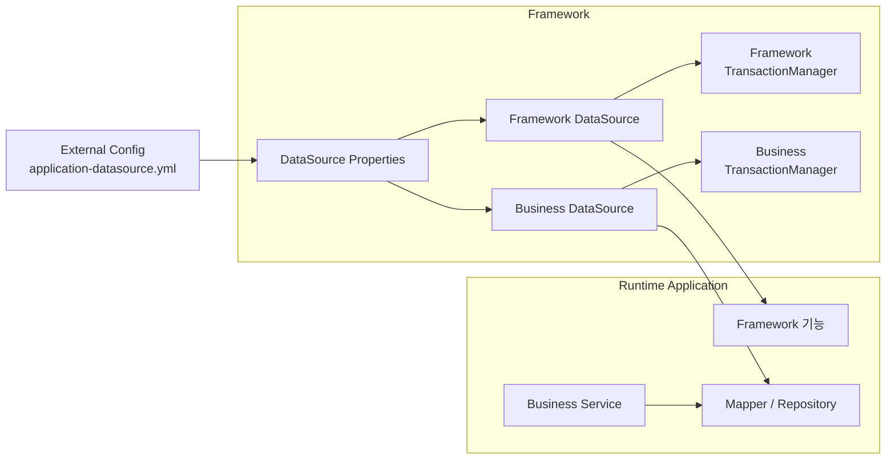
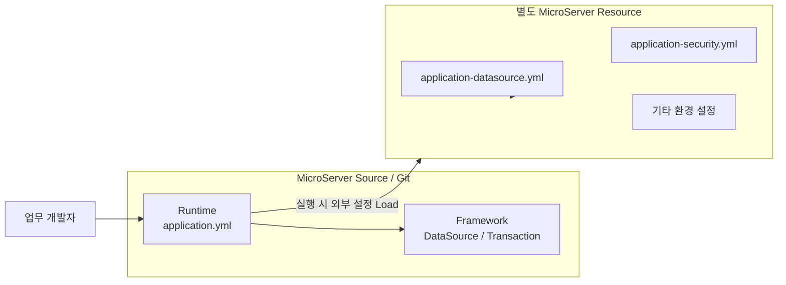
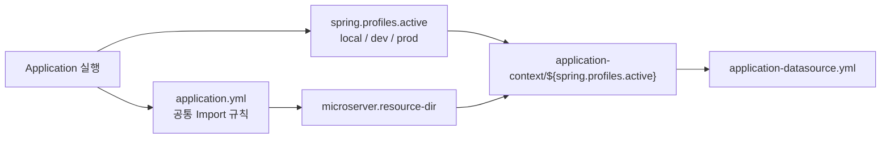
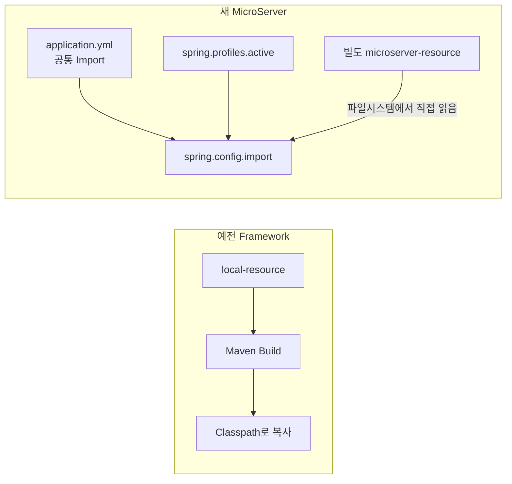

# DataSource 구성 원칙과 외부 설정

두 DB의 역할과 외부 리소스 구조를 정하고, Profile별 접속 설정을 연결한다.

1. [DataSource 구성 원칙과 외부 설정](datasource_framework_setup.md)
2. [DataSource Bean 구현과 등록](datasource_bean_setup.md)
3. [DataSource 접속 검증과 운영 기준](datasource_connection_verification.md)

## 1. 구성 목표

MicroServer Framework에서 Database 연결을 공통 기능으로 제공한다.

기본적으로 다음 두 DataSource를 구성한다.

- **Framework DataSource**: Framework 자체 기능에서 사용하는 Database
- **Business DataSource**: Runtime Application의 도메인 업무에서
    사용하는 Database

Runtime 개발자는 DataSource와 Connection Pool을 직접 생성하지 않고
Framework가 제공하는 Bean을 사용한다.



---
## 2. 이번 구성의 핵심 원칙

DataSource는 Runtime의 모든 Database 접근이 시작되는 기반 기능이다. 각 업무 프로젝트가 DataSource 생성 방식, Connection Pool, Bean 이름, TransactionManager 구성을 각각 구현하면 프로젝트마다 설정 방식이 달라지고 운영 기준도 분산된다.

따라서 **Database 연결을 만드는 기술적인 책임은 Framework가 담당하고, 어떤 Database에 접속할 것인지에 대한 환경별 값과 실제 업무 SQL은 Runtime 및 실행환경의 책임으로 분리한다.**

### Framework가 담당하는 영역

Framework는 DataSource Property 구조, HikariCP 기반 DataSource 생성, Framework / Business DataSource Bean, Bean 이름과 `@Primary` 기준, TransactionManager, 향후 MyBatis / JPA 연결 기반을 표준화한다.

이 기능들을 Framework에 두는 이유는 **업무 개발자가 Database 연결 인프라를 프로젝트마다 다시 구성하지 않도록 하기 위해서**이다. Runtime 개발자는 Framework가 HikariCP를 어떻게 생성하고 TransactionManager를 어떻게 등록하는지 몰라도 업무 개발이 가능해야 한다.

### Runtime이 담당하는 영역

Runtime은 실제 도메인 업무를 구현하므로 **업무 Mapper / Repository, Mapper XML, 업무 SQL, Service의 Transaction 범위**를 담당한다.

특히 Mapper Interface, Mapper XML, 업무 SQL은 Framework가 아니라 Runtime에 둔다. SQL은 특정 업무 테이블과 도메인 규칙에 종속되므로 공통 Framework에 포함하면 Framework와 업무가 강하게 결합되기 때문이다.

반면 Runtime은 `DataSource` 자체를 생성하거나 HikariCP를 직접 구성하지 않는다. Framework가 제공하는 Business DataSource와 Transaction 기반 위에서 업무 Data Access를 구현한다.

### Framework DataSource와 Business DataSource를 분리한다

**Framework DataSource**는 Framework 자체 기능에서 사용하는 Database 연결이고, **Business DataSource**는 Runtime의 실제 도메인 업무에서 사용하는 Database 연결이다.

두 DataSource를 명시적으로 분리하면 Framework 기능이 업무 Database에 불필요하게 의존하는 것을 줄이고, Connection Pool과 Transaction 정책도 독립적으로 관리할 수 있다.

### 접속정보는 Framework와 Runtime 소스에서 분리한다

DB URL, 계정, Password 같은 값은 환경마다 다르고 민감정보를 포함할 수 있다.

따라서 Framework JAR이나 Runtime 소스에 직접 작성하지 않고 **실행환경의 외부 Resource에서 제공**한다.

여기서 외부 설정은 단순히 Classpath 밖이라는 의미만으로 끝나지 않는다. MicroServer에서는 가능하면 **업무 개발자가 사용하는 Git Project와 실제 환경별 설정파일의 저장 위치 자체를 분리**하여 관리한다.

---
## 3. 권장 프로젝트 및 외부 Resource 구조

### 3.1 Classpath 외부와 개발 프로젝트 외부는 다르다

`file:` 방식으로 읽는 `./config/application-context/local/application-datasource.yml`은 **Classpath 외부 설정파일**이다.

하지만 `config` 디렉터리가 업무 개발자가 Clone하는 Git Project 안에 있으면 개발자는 파일 내용을 볼 수 있다.

| 구분 | 의미 |
| --- | --- |
| Classpath 외부 | 설정파일이 Runtime JAR/Classpath에 포함되지 않음 |
| 개발 프로젝트 외부 | 설정파일 자체가 업무 개발자의 Source/Git Project와 분리됨 |

MicroServer는 두 번째까지 포함하여 **실제 DB 접속정보와 보안 관련 환경설정을 Application Source와 별도의 Resource 영역에서 관리**하는 것을 권장한다.

### 3.2 권장 구조

```text
[업무 개발자가 사용하는 MicroServer Project]

microserver/
├── framework/
├── runtime/
│   └── src/main/resources/
│       └── application.yml
├── build.gradle
└── settings.gradle


[별도로 관리하는 MicroServer Resource]

microserver-resource/
└── config/
    └── application-context/
        ├── local/
        │   ├── application-datasource.yml
        │   ├── application-security.yml
        │   └── ...
        ├── dev/
        │   ├── application-datasource.yml
        │   ├── application-security.yml
        │   └── ...
        └── prod/
            ├── application-datasource.yml
            ├── application-security.yml
            └── ...
```



멀티프로젝트 전환 전 현재 단일 프로젝트에서 DataSource를 검증할 때도 같은 원칙을 적용할 수 있다. Java 코드는 현재 프로젝트에 두고 외부 Resource만 별도 위치에서 관리한다.

### 3.3 환경별 설정은 동일한 한 벌로 관리한다

Local / Dev / Prod 환경마다 파일 종류를 다르게 만들지 않고 동일한 이름과 책임을 유지한다.

```text
local/
├── application-datasource.yml
├── application-security.yml
└── ...

dev/
├── application-datasource.yml
├── application-security.yml
└── ...

prod/
├── application-datasource.yml
├── application-security.yml
└── ...
```

환경이 달라질 때 바뀌는 것은 파일의 역할이 아니라 **파일 안의 실제 설정값**이다. 향후 Logging, JWT, SSL, Kafka 등의 설정도 같은 원칙으로 확장한다.

### 3.4 외부 Resource 분리의 목적과 한계

외부 Resource를 분리하면 DB URL과 환경별 시스템 주소가 Source/JAR에 포함되는 것을 막고, 업무 Git Repository와 운영 설정을 분리할 수 있다. 또한 동일한 Application Build 결과물을 환경별 설정만 바꾸어 실행할 수 있다.

다만 **외부 파일로 분리했다고 해서 보안이 완성되는 것은 아니다.** 해당 서버나 Resource 디렉터리에 읽기 권한이 있는 사용자는 파일을 볼 수 있다.

따라서 운영환경에서는 OS 파일 권한, 배포 계정 권한, 환경변수 또는 별도의 Secret 관리방식을 함께 적용해야 한다. Password 같은 Secret은 가능하면 YAML에 평문으로 저장하지 않는다.

---

## 4. 외부 DataSource 설정파일 작성

외부 Resource Root는 Application Source Project 밖의 별도 위치를 사용한다.

예:

```text
/opt/microserver-resource
```

macOS나 개발 PC에서는 실제 사용 가능한 별도 디렉터리로 변경하면 된다. 중요한 것은 특정 절대경로가 아니라 **Source Project와 Resource Root의 분리**이다.

Local DataSource 설정파일:

```text
${microserver.resource-dir}/config/application-context/local/application-datasource.yml
```

```yaml
microserver:
  datasource:

    framework:
      driver-class-name: org.h2.Driver
      jdbc-url: jdbc:h2:mem:frameworkdb;DB_CLOSE_DELAY=-1
      username: sa
      password:
      maximum-pool-size: 5
      minimum-idle: 1

    business:
      driver-class-name: org.h2.Driver
      jdbc-url: jdbc:h2:mem:businessdb;DB_CLOSE_DELAY=-1
      username: sa
      password:
      maximum-pool-size: 10
      minimum-idle: 1
```

첫 검증은 Oracle 등 실제 외부 DB보다 H2를 사용한다. Framework 설정 문제와 네트워크, DB 계정, 방화벽 같은 외부 요인을 분리해서 확인하기 위해서다.

Framework / Business를 서로 다른 H2 Database로 구성하여 **두 DataSource가 실제로 독립된 설정과 Connection Pool로 생성되는지** 검증한다.

!!! note "설정 Prefix"
    `spring.datasource` 대신 `microserver.datasource`를 사용한다.

    Spring Boot 기본 단일 DataSource 자동설정과 구분하고, MicroServer Framework가 Framework / Business 두 DataSource를 명시적으로 생성하고 관리하기 위한 것이다.

---

## 5. Spring Profile과 외부 설정 연결

### 5.1 `application.properties`를 `application.yml`로 전환

현재 Spring Initializr 프로젝트의 기본 설정파일은 `src/main/resources/application.properties`이다.

```properties
spring.application.name=microserver
```

Spring Boot는 Properties와 YAML을 모두 지원한다. YAML 전환은 외부 YAML을 읽기 위한 필수조건이 아니라 **MicroServer의 설정 관리 기준**이다.

DataSource, Security, MyBatis, Logging 등 계층적인 Framework 설정이 늘어날 것을 고려하여 `application.yml`을 공통 설정 진입점으로 사용한다.

### 5.2 외부 Resource Import는 `application.yml`에서 공통 관리

MicroServer에서는 Local / Dev / Prod마다 동일한 종류의 외부 설정파일을 사용한다. 따라서 각 `application-local.yml`, `application-dev.yml`, `application-prod.yml`에 동일한 `spring.config.import` 목록을 반복하지 않는다.

대신 **`application.yml`에서 `${spring.profiles.active}`를 사용하여 현재 활성 Profile에 대응하는 외부 Resource 디렉터리를 선택**한다.

```yaml
spring:
  application:
    name: microserver

  config:
    import:
      - file:${microserver.resource-dir}/config/application-context/${spring.profiles.active}/application-datasource.yml
```

실행 Profile이 `local`이면 위 경로는 다음 파일을 가리킨다.

```text
${microserver.resource-dir}/config/application-context/local/application-datasource.yml
```

`dev`이면 다음과 같이 자동으로 변경된다.

```text
${microserver.resource-dir}/config/application-context/dev/application-datasource.yml
```

즉 Application Source에서 환경별 Import 경로를 반복해서 관리하지 않고 **Profile 값만으로 동일한 Resource 구조의 환경별 설정 한 벌을 선택**한다.



### 5.3 Framework 설정파일이 늘어나도 Import 규칙은 한 곳에서 관리

향후 Security, Web, Cache, Logging 등의 외부 설정이 추가되어도 Import 목록은 `application.yml` 한 곳에서 확장한다.

```yaml
spring:
  application:
    name: microserver

  config:
    import:
      - file:${microserver.resource-dir}/config/application-context/${spring.profiles.active}/application-datasource.yml
      - file:${microserver.resource-dir}/config/application-context/${spring.profiles.active}/application-security.yml
      - file:${microserver.resource-dir}/config/application-context/${spring.profiles.active}/application-web.yml
      - file:${microserver.resource-dir}/config/application-context/${spring.profiles.active}/application-cache.yml
      - file:${microserver.resource-dir}/config/application-context/${spring.profiles.active}/application-logging.yml
```

이 방식의 핵심은 **환경별로 Import 목록을 복제하지 않는 것**이다. Local / Dev / Prod Resource는 동일한 파일명과 책임을 유지하고 실제 설정값만 환경에 따라 달라진다.

```text
microserver-resource/
└── config/
    └── application-context/
        ├── local/
        │   ├── application-datasource.yml
        │   ├── application-security.yml
        │   └── ...
        ├── dev/
        │   ├── application-datasource.yml
        │   ├── application-security.yml
        │   └── ...
        └── prod/
            ├── application-datasource.yml
            ├── application-security.yml
            └── ...
```

### 5.4 MicroServer Profile 운영 기준

`${spring.profiles.active}` 값을 Resource 디렉터리명으로 직접 사용하므로 MicroServer의 **실행환경 Profile은 단일 환경 Profile을 사용하는 것을 표준으로 한다.**

```text
local

dev

prod
```

예를 들어 다음과 같이 하나의 환경 Profile을 활성화한다.

```text
--spring.profiles.active=local
```

`local,test`처럼 여러 Profile을 동시에 활성화하면 `${spring.profiles.active}` 값 전체를 Resource 경로로 사용할 때 디렉터리 의미가 불명확해질 수 있다. 따라서 **외부 Resource 환경을 선택하는 Profile은 하나만 활성화한다.**

향후 기능성 Profile이 추가로 필요해지는 경우에는 실행환경 Profile과 기능 Profile의 역할을 분리하는 별도 설계를 검토한다.

### 5.5 `application-{profile}.yml` 사용 기준

현재 구조에서는 외부 Resource 선택을 위해 `application-local.yml`, `application-dev.yml`, `application-prod.yml`을 반드시 만들 필요가 없다.

환경에 관계없이 동일한 설정 구조를 사용한다면 다음과 같이 `application.yml` 하나로 충분하다.

```text
src/main/resources/
└── application.yml
```

다만 특정 환경에서만 필요한 **Application 자체의 Spring 설정**이 생기면 `application-{profile}.yml`을 사용할 수 있다. 이 경우에도 외부 Resource Import 목록을 환경별 파일마다 반복하지 않고 `application.yml`의 공통 Import 규칙은 유지한다.

즉 역할을 다음처럼 구분한다.

| 설정파일 | 역할 |
| --- | --- |
| `application.yml` | MicroServer 공통 설정 및 외부 Resource Import 규칙 |
| `application-{profile}.yml` | 필요한 경우에만 해당 환경의 Application 전용 차이값 |
| 외부 `application-*.yml` | DataSource, Security 등 실제 환경별 Framework 설정값 |

### 5.6 Resource Root 지정

외부 Resource가 `/opt/microserver-resource`에 있다면 실행환경에서 다음 값을 제공한다.

```text
microserver.resource-dir=/opt/microserver-resource
```

JAR 실행 예:

```bash
java \
  -Dmicroserver.resource-dir=/opt/microserver-resource \
  -jar runtime.jar \
  --spring.profiles.active=local
```

VS Code Local 실행에서는 `launch.json`의 `vmArgs`와 `args`를 이용할 수 있다.

```json
{
  "vmArgs": "-Dmicroserver.resource-dir=${workspaceFolder}/microserver_resource",
  "args": "--spring.profiles.active=local"
}
```

개발 PC와 운영서버의 실제 Resource Root는 달라도 된다. Application은 `${microserver.resource-dir}`만 참조하므로 Source 수정 없이 실행환경에서 위치를 결정할 수 있다.

!!! note "Resource Root와 Secret"
    `microserver.resource-dir`은 외부 Resource의 **위치**를 전달하는 값이다.

    DB Password 같은 Secret 자체를 이 값에 넣는 것이 아니다. Secret은 환경변수나 별도 Secret 관리기능을 통해 외부 설정파일에서 참조하도록 구성할 수 있다.

### 5.7 `optional:` 사용 기준

초기 경로 검증 중에는 다음처럼 사용할 수 있다.

```yaml
spring:
  config:
    import:
      - optional:file:${microserver.resource-dir}/config/application-context/${spring.profiles.active}/application-datasource.yml
```

하지만 DataSource 설정은 Runtime 실행에 필요한 핵심 설정이므로 구성이 안정화되면 `optional:`을 제거하여 설정 누락을 기동 시점에 발견하도록 한다.

### 5.8 예전 방식과 이번 방식

예전 Framework도 Spring Profile로 환경을 선택하고 환경별 외부 설정 한 벌을 관리했다. 이 설계 원칙은 유지한다.

이번 구조에서는 한 단계 더 정리하여 **공통 Import 규칙을 `application.yml`에 집중시키고 활성 Profile을 외부 Resource 디렉터리 선택값으로 사용**한다.

또한 외부 Resource를 Build 과정에서 Classpath로 복사하지 않는다.



새 구조에서는 외부 Resource를 끝까지 외부에 유지하고 Spring Boot의 Externalized Configuration으로 실행 시 직접 읽는다.

이를 통해 **환경별 설정 분리라는 기존 장점은 유지하면서, 환경별 Application 설정파일에 반복되던 Import 정의와 Classpath 복사 Build 작업을 제거**한다.

---
