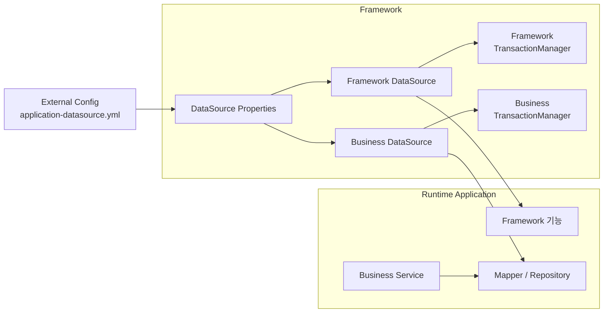
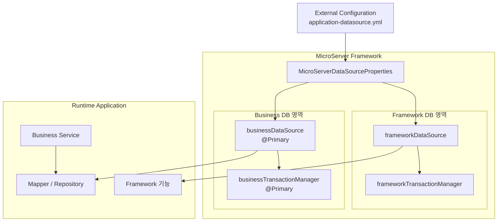

# DataSource Framework 구성 및 접속 검증

## 1. 구성 목표

MicroServer Framework에서 Database 연결을 공통 기능으로 제공한다.

기본적으로 다음 두 DataSource를 구성한다.

- **Framework DataSource**: Framework 자체 기능에서 사용하는 Database
- **Business DataSource**: Runtime Application의 도메인 업무에서 사용하는 Database

Runtime 개발자는 DataSource와 Connection Pool을 직접 생성하지 않고 Framework가 제공하는 Bean을 사용한다.



---

## 2. 이번 구성의 핵심 원칙

### Framework가 담당한다

- DataSource Property 정의
- HikariCP DataSource 생성
- Framework / Business DataSource Bean 등록
- DataSource Bean 이름 표준화
- TransactionManager 구성
- 향후 MyBatis / JPA 연결 기반

### Runtime이 담당한다

- 환경별 실제 DB 접속정보 제공
- 업무 Mapper / Repository
- Mapper XML과 업무 SQL
- 업무 Transaction 범위 지정

### 접속정보는 외부 설정으로 관리한다

DB URL, 계정, Password와 같은 환경별 값은 Framework JAR에 포함하지 않는다.

Spring Boot의 외부 설정 기능을 사용하여 실행 시점에 설정을 읽는다.

---

## 3. 권장 프로젝트 구조

현재 멀티프로젝트를 다음과 같이 구성한다고 가정한다.

```text
microserver/
├── build.gradle
├── settings.gradle
│
├── framework/
│   └── src/main/java/
│       └── .../framework/
│           └── datasource/
│               ├── MicroServerDataSourceProperties.java
│               └── MicroServerDataSourceConfig.java
│
├── runtime/
│   ├── src/main/java/
│   └── src/main/resources/
│       └── application.yml
│
└── config/
    └── local/
        └── application-datasource.yml
```

`config/local/application-datasource.yml`은 **classpath Resource가 아니라 외부 설정파일**이다.

따라서 Build 시 Framework 또는 Runtime JAR 내부로 복사하지 않는다.

---

## 4. 외부 설정파일 작성

`config/local/application-datasource.yml`을 생성한다.

```yaml
microserver:
  datasource:

    framework:
      driver-class-name: org.h2.Driver
      jdbc-url: jdbc:h2:mem:frameworkdb;DB_CLOSE_DELAY=-1
      username: sa
      password:
      maximum-pool-size: 5
      minimum-idle: 1

    business:
      driver-class-name: org.h2.Driver
      jdbc-url: jdbc:h2:mem:businessdb;DB_CLOSE_DELAY=-1
      username: sa
      password:
      maximum-pool-size: 10
      minimum-idle: 1
```

첫 구성과 접속 검증은 외부 Oracle 등 실제 DB보다 H2를 사용한다.

이렇게 하면 Framework 구성 자체의 문제와 네트워크/DB 계정 문제를 분리해서 확인할 수 있다. H2 접속이 정상적으로 확인된 후 실제 Oracle 또는 프로젝트 DB 설정으로 변경한다.

!!! note "설정 Prefix"
    `spring.datasource`를 직접 사용하지 않고 `microserver.datasource`를 사용한다.

    Spring Boot 기본 단일 DataSource 자동설정과 구분하고, Framework가 두 DataSource를 명시적으로 관리하기 위한 것이다.

---

## 5. Runtime에서 외부 YAML 읽기

`runtime/src/main/resources/application.yml`에 다음 설정을 추가한다.

```yaml
spring:
  application:
    name: microserver-runtime

  config:
    import: optional:file:./config/local/application-datasource.yml
```

프로젝트 Root에서 Runtime을 실행하면 다음 파일을 읽는다.

```text
microserver/config/local/application-datasource.yml
```

외부 설정파일이 반드시 존재해야 애플리케이션을 실행하도록 하려면 `optional:`을 제거한다.

```yaml
spring:
  config:
    import: file:./config/local/application-datasource.yml
```

개발 초기에는 설정파일 경로 문제로 Application 전체가 기동되지 않는 상황을 피하기 위해 `optional:`을 사용할 수 있다. DataSource 구성이 안정화된 이후 필수 설정으로 전환하는 것을 권장한다.

### 다른 실행 디렉터리에서 실행하는 경우

상대경로는 Java Process의 현재 작업 디렉터리를 기준으로 한다.

IDE와 배포환경에서 작업 디렉터리가 달라질 수 있으므로 운영에서는 외부 경로를 환경변수 또는 실행 인자로 전달하는 방식을 권장한다.

예:

```bash
java -jar runtime.jar \
  --spring.config.additional-location=optional:file:/opt/microserver/config/
```

또는 환경변수:

```bash
SPRING_CONFIG_ADDITIONAL_LOCATION=optional:file:/opt/microserver/config/
```

---

## 6. Framework 의존성 추가

Framework 프로젝트에서 HikariCP와 JDBC를 사용할 수 있도록 의존성을 구성한다.

Spring Boot JDBC Starter를 사용하면 HikariCP가 기본 Connection Pool로 포함된다.

`framework/build.gradle` 예시:

```groovy
dependencies {
    implementation 'org.springframework.boot:spring-boot-starter-jdbc'

    // 초기 DataSource 구성 및 접속 테스트용
    runtimeOnly 'com.h2database:h2'
}
```

실제 Oracle을 사용할 단계에서는 JDBC Driver를 프로젝트 정책에 맞게 추가한다.

---

## 7. DataSource Property 클래스 작성

Framework에 다음 클래스를 생성한다.

```text
framework
└── src/main/java
    └── .../framework/datasource
        └── MicroServerDataSourceProperties.java
```

```java
package com.microserver.framework.datasource;

import org.springframework.boot.context.properties.ConfigurationProperties;

@ConfigurationProperties(prefix = "microserver.datasource")
public class MicroServerDataSourceProperties {

    private final DataSourceProperty framework = new DataSourceProperty();
    private final DataSourceProperty business = new DataSourceProperty();

    public DataSourceProperty getFramework() {
        return framework;
    }

    public DataSourceProperty getBusiness() {
        return business;
    }

    public static class DataSourceProperty {
        private String driverClassName;
        private String jdbcUrl;
        private String username;
        private String password;
        private int maximumPoolSize = 10;
        private int minimumIdle = 1;

        public String getDriverClassName() {
            return driverClassName;
        }

        public void setDriverClassName(String driverClassName) {
            this.driverClassName = driverClassName;
        }

        public String getJdbcUrl() {
            return jdbcUrl;
        }

        public void setJdbcUrl(String jdbcUrl) {
            this.jdbcUrl = jdbcUrl;
        }

        public String getUsername() {
            return username;
        }

        public void setUsername(String username) {
            this.username = username;
        }

        public String getPassword() {
            return password;
        }

        public void setPassword(String password) {
            this.password = password;
        }

        public int getMaximumPoolSize() {
            return maximumPoolSize;
        }

        public void setMaximumPoolSize(int maximumPoolSize) {
            this.maximumPoolSize = maximumPoolSize;
        }

        public int getMinimumIdle() {
            return minimumIdle;
        }

        public void setMinimumIdle(int minimumIdle) {
            this.minimumIdle = minimumIdle;
        }
    }
}
```

이 클래스의 역할은 YAML의 다음 구조를 Java 객체로 변환하는 것이다.

```text
microserver.datasource
├── framework
│   ├── jdbc-url
│   ├── username
│   └── ...
└── business
    ├── jdbc-url
    ├── username
    └── ...
```

---

## 8. Framework DataSource Configuration 작성

다음 클래스를 생성한다.

```text
framework
└── src/main/java
    └── .../framework/datasource
        └── MicroServerDataSourceConfig.java
```

```java
package com.microserver.framework.datasource;

import com.zaxxer.hikari.HikariConfig;
import com.zaxxer.hikari.HikariDataSource;
import javax.sql.DataSource;

import org.springframework.beans.factory.annotation.Qualifier;
import org.springframework.boot.context.properties.EnableConfigurationProperties;
import org.springframework.context.annotation.Bean;
import org.springframework.context.annotation.Configuration;
import org.springframework.context.annotation.Primary;
import org.springframework.jdbc.datasource.DataSourceTransactionManager;
import org.springframework.transaction.PlatformTransactionManager;

@Configuration
@EnableConfigurationProperties(MicroServerDataSourceProperties.class)
public class MicroServerDataSourceConfig {

    @Bean(name = "frameworkDataSource")
    public DataSource frameworkDataSource(
            MicroServerDataSourceProperties properties) {

        return createDataSource(
                "microserver-framework-pool",
                properties.getFramework());
    }

    @Primary
    @Bean(name = "businessDataSource")
    public DataSource businessDataSource(
            MicroServerDataSourceProperties properties) {

        return createDataSource(
                "microserver-business-pool",
                properties.getBusiness());
    }

    @Bean(name = "frameworkTransactionManager")
    public PlatformTransactionManager frameworkTransactionManager(
            @Qualifier("frameworkDataSource") DataSource dataSource) {

        return new DataSourceTransactionManager(dataSource);
    }

    @Primary
    @Bean(name = "businessTransactionManager")
    public PlatformTransactionManager businessTransactionManager(
            @Qualifier("businessDataSource") DataSource dataSource) {

        return new DataSourceTransactionManager(dataSource);
    }

    private DataSource createDataSource(
            String poolName,
            MicroServerDataSourceProperties.DataSourceProperty property) {

        HikariConfig config = new HikariConfig();

        config.setPoolName(poolName);
        config.setDriverClassName(property.getDriverClassName());
        config.setJdbcUrl(property.getJdbcUrl());
        config.setUsername(property.getUsername());
        config.setPassword(property.getPassword());
        config.setMaximumPoolSize(property.getMaximumPoolSize());
        config.setMinimumIdle(property.getMinimumIdle());

        return new HikariDataSource(config);
    }
}
```

### 왜 Business DataSource를 `@Primary`로 지정하는가

Runtime의 대부분 Database 작업은 업무 DB를 사용한다.

따라서 DataSource 또는 TransactionManager를 별도 Qualifier 없이 주입할 때 Business DataSource가 기본으로 선택되도록 한다.

Framework DB를 사용하는 Framework 기능은 다음처럼 Bean 이름을 명시한다.

```java
@Qualifier("frameworkDataSource")
```

이 기준을 사용하면 업무 개발자가 일반적인 업무 코드에서 Framework DB를 실수로 사용하는 가능성을 줄일 수 있다.

---

## 9. Runtime이 Framework Configuration을 인식하도록 구성

초기 구현 단계에서는 Runtime의 `@SpringBootApplication` package 하위에 Framework package가 포함되지 않을 수 있다.

가장 단순한 검증 방법은 Runtime Application에서 Framework Configuration을 명시적으로 Import하는 것이다.

```java
package com.microserver.runtime;

import com.microserver.framework.datasource.MicroServerDataSourceConfig;
import org.springframework.boot.SpringApplication;
import org.springframework.boot.autoconfigure.SpringBootApplication;
import org.springframework.context.annotation.Import;

@SpringBootApplication
@Import(MicroServerDataSourceConfig.class)
public class RuntimeApplication {

    public static void main(String[] args) {
        SpringApplication.run(RuntimeApplication.class, args);
    }
}
```

접속 검증이 완료된 뒤 Framework 자동설정(Auto Configuration)으로 전환하면 Runtime에서 `@Import`를 제거할 수 있다.

첫 구현에서는 동작 구조를 명확하게 확인하기 위해 명시적인 `@Import` 방식으로 시작한다.

---

## 10. Framework DataSource 접속 테스트

Framework DB 접속을 검증하는 테스트를 작성한다.

```java
package com.microserver.runtime;

import static org.assertj.core.api.Assertions.assertThat;

import java.sql.Connection;
import javax.sql.DataSource;

import org.junit.jupiter.api.Test;
import org.springframework.beans.factory.annotation.Autowired;
import org.springframework.beans.factory.annotation.Qualifier;
import org.springframework.boot.test.context.SpringBootTest;

@SpringBootTest
class FrameworkDataSourceConnectionTest {

    @Autowired
    @Qualifier("frameworkDataSource")
    private DataSource dataSource;

    @Test
    void frameworkDataSourceConnectionTest() throws Exception {
        try (Connection connection = dataSource.getConnection()) {
            assertThat(connection.isClosed()).isFalse();
            System.out.println(
                    "Framework DB URL = "
                    + connection.getMetaData().getURL());
        }
    }
}
```

정상 결과 예:

```text
Framework DB URL = jdbc:h2:mem:frameworkdb
```

---

## 11. Business DataSource 접속 테스트

업무 DB도 독립적으로 검증한다.

```java
package com.microserver.runtime;

import static org.assertj.core.api.Assertions.assertThat;

import java.sql.Connection;
import javax.sql.DataSource;

import org.junit.jupiter.api.Test;
import org.springframework.beans.factory.annotation.Autowired;
import org.springframework.beans.factory.annotation.Qualifier;
import org.springframework.boot.test.context.SpringBootTest;

@SpringBootTest
class BusinessDataSourceConnectionTest {

    @Autowired
    @Qualifier("businessDataSource")
    private DataSource dataSource;

    @Test
    void businessDataSourceConnectionTest() throws Exception {
        try (Connection connection = dataSource.getConnection()) {
            assertThat(connection.isClosed()).isFalse();
            System.out.println(
                    "Business DB URL = "
                    + connection.getMetaData().getURL());
        }
    }
}
```

정상 결과 예:

```text
Business DB URL = jdbc:h2:mem:businessdb
```

두 테스트가 각각 다른 URL을 출력해야 한다.

---

## 12. Application 기동 시 두 DataSource 동시 확인

테스트뿐 아니라 실제 Runtime 기동 시 두 DataSource가 정상 생성되는지도 확인한다.

임시 검증용 `ApplicationRunner`를 Runtime에 작성한다.

```java
package com.microserver.runtime.verify;

import java.sql.Connection;
import javax.sql.DataSource;

import org.springframework.beans.factory.annotation.Qualifier;
import org.springframework.boot.ApplicationArguments;
import org.springframework.boot.ApplicationRunner;
import org.springframework.stereotype.Component;

@Component
public class DataSourceConnectionVerifier implements ApplicationRunner {

    private final DataSource frameworkDataSource;
    private final DataSource businessDataSource;

    public DataSourceConnectionVerifier(
            @Qualifier("frameworkDataSource") DataSource frameworkDataSource,
            @Qualifier("businessDataSource") DataSource businessDataSource) {

        this.frameworkDataSource = frameworkDataSource;
        this.businessDataSource = businessDataSource;
    }

    @Override
    public void run(ApplicationArguments args) throws Exception {
        verify("Framework", frameworkDataSource);
        verify("Business", businessDataSource);
    }

    private void verify(String name, DataSource dataSource) throws Exception {
        try (Connection connection = dataSource.getConnection()) {
            System.out.println(
                    "[DataSource OK] " + name
                    + " : " + connection.getMetaData().getURL());
        }
    }
}
```

Application 기동 로그에서 다음과 같이 확인한다.

```text
[DataSource OK] Framework : jdbc:h2:mem:frameworkdb
[DataSource OK] Business  : jdbc:h2:mem:businessdb
```

접속 검증이 끝나면 이 임시 클래스는 제거한다. 운영용 Health Check는 이후 Actuator와 Framework 관리기능을 설계할 때 별도로 구성한다.

---

## 13. Transaction 사용 기준

두 개의 TransactionManager가 존재하므로 어느 DB의 Transaction인지 명확해야 한다.

### 일반 업무 Transaction

Business TransactionManager를 `@Primary`로 지정했으므로 일반적인 업무에서는 다음처럼 사용할 수 있다.

```java
@Transactional
public void processBusiness() {
    // Business DB 처리
}
```

### Framework DB Transaction

Framework DB를 사용하는 기능에서는 TransactionManager를 명시한다.

```java
@Transactional(transactionManager = "frameworkTransactionManager")
public void updateFrameworkData() {
    // Framework DB 처리
}
```

### 주의

Framework DB와 Business DB를 하나의 메서드에서 동시에 변경한다고 해서 두 Database의 Transaction이 자동으로 하나의 Transaction이 되는 것은 아니다.

두 DB를 하나의 원자적 Transaction으로 묶어야 하는 요구사항이 생기면 분산 Transaction 또는 업무 보상 방식 등을 별도로 설계한다.

초기 Framework에서는 두 DataSource의 Transaction을 독립적으로 관리한다.

---

## 14. 실제 DB로 변경

H2 검증이 완료되면 `application-datasource.yml`의 접속정보만 실제 환경에 맞게 변경한다.

예시:

```yaml
microserver:
  datasource:

    framework:
      driver-class-name: oracle.jdbc.OracleDriver
      jdbc-url: jdbc:oracle:thin:@//framework-db-host:1521/SERVICE
      username: ${FRAMEWORK_DB_USERNAME}
      password: ${FRAMEWORK_DB_PASSWORD}
      maximum-pool-size: 10
      minimum-idle: 2

    business:
      driver-class-name: oracle.jdbc.OracleDriver
      jdbc-url: jdbc:oracle:thin:@//business-db-host:1521/SERVICE
      username: ${BUSINESS_DB_USERNAME}
      password: ${BUSINESS_DB_PASSWORD}
      maximum-pool-size: 30
      minimum-idle: 5
```

Password를 YAML에 직접 저장하지 않고 환경변수나 향후 Secret 관리 기능을 이용한다.

---

## 15. 최종 구조



이 구조에서 Framework는 **두 DataSource를 생성하고 사용할 수 있는 기술 기반**을 제공한다.

Runtime은 Framework 내부의 DataSource 생성 방법을 알 필요가 없으며, 업무 Database 접근에 필요한 Mapper / Repository와 업무 Transaction 범위에 집중한다.

---

## 16. 다음 단계

두 DataSource의 생성과 접속 검증이 완료되면 다음 순서로 확장한다.

1. Business DataSource와 MyBatis 연결
2. Runtime Mapper Interface / Mapper XML 작성
3. Business `SqlSessionFactory` / `SqlSessionTemplate` 구성
4. Framework DB 전용 MyBatis 구성이 필요한지 검토
5. Transaction 동작 검증
6. DataSource Health Check 구성
7. Framework Auto Configuration 전환

DataSource 기반이 검증되기 전에는 MyBatis Mapper 구조를 먼저 확장하지 않는다. 먼저 **두 DataSource가 Framework에서 생성되고 Runtime에서 정확하게 구분되어 사용되는 것**을 확인한다.
