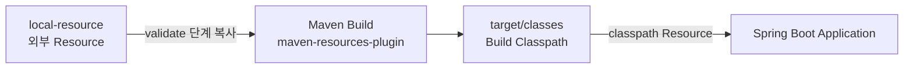
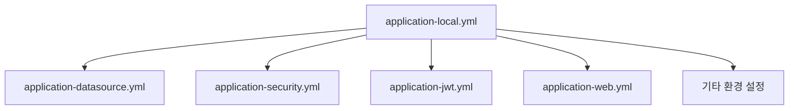
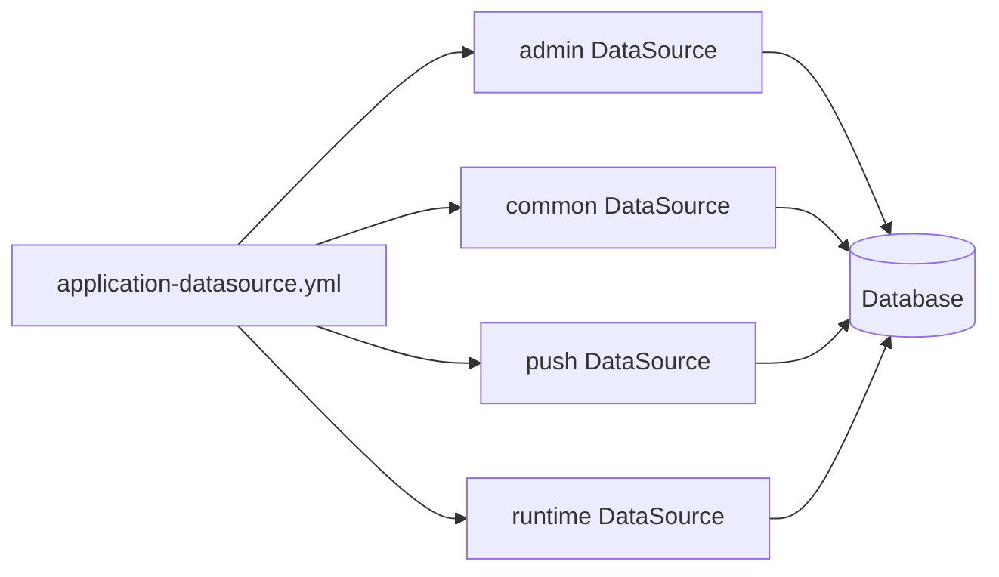
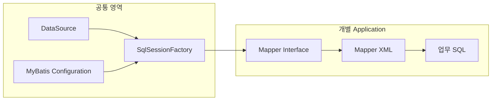
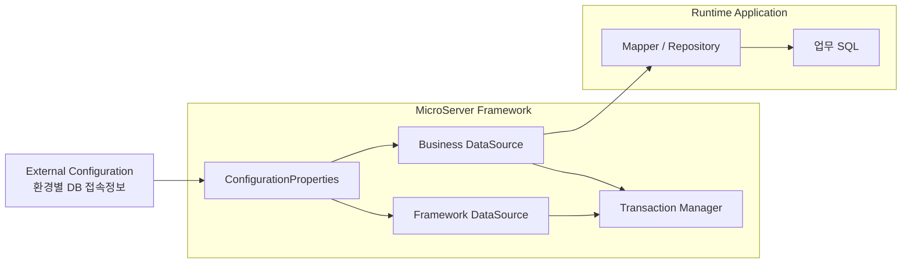

# 기존 MicroServer DataSource 구성 분석

## 1. 목적

기존 MicroServer Framework에서 외부 Resource, 환경별 YAML, DataSource, MyBatis 설정을 어떤 방식으로 구성했는지 정리한다.

이 문서는 기존 구조를 그대로 재사용하기 위한 문서가 아니라, 신규 멀티프로젝트 Framework의 DataSource 구조를 설계하기 위한 기준 자료로 사용한다.

---

## 2. 기존 프로젝트 구성

기존 프로젝트는 `microserver-admin`, `module-common`, `microserver-runtime` 등의 실행/공통 프로젝트와 별도로 `local-resource` 디렉터리를 두었다.

```text
001_microserver/
├── local-resource/
│   ├── cert/
│   ├── config/
│   │   └── application-context/
│   │       ├── dev/
│   │       └── local/
│   │           ├── application-local.yml
│   │           ├── application-datasource.yml
│   │           ├── application-security.yml
│   │           ├── application-jwt.yml
│   │           ├── application-web.yml
│   │           └── ...
│   ├── logback/
│   └── mybatis/
├── microserver-admin/
├── microserver-module/
└── microserver-runtime/
```

`local-resource`는 환경별 설정, 인증서, Logback, MyBatis 공통 설정 등 애플리케이션 외부 Resource를 한 위치에서 관리하기 위한 용도로 사용했다.

---

## 3. 기존 외부 Resource 처리 방식

### 3.1 문제

Spring Boot executable JAR의 기본 classpath는 애플리케이션 JAR 내부의 `BOOT-INF/classes`, `BOOT-INF/lib`를 중심으로 구성된다.

기존 MicroServer에서는 `local-resource`의 YAML과 Logback Resource를 애플리케이션에서 classpath Resource처럼 사용하기 위해 Maven Build 과정에서 필요한 파일을 `target/classes`로 복사했다.

### 3.2 Maven Resource 복사

기존 `pom.xml`의 `maven-resources-plugin`은 `validate` 단계에서 외부 Resource를 Build classpath로 복사한다.

```xml
<execution>
    <id>copy-resources</id>
    <phase>validate</phase>
    <goals>
        <goal>copy-resources</goal>
    </goals>
    <configuration>
        <outputDirectory>${basedir}/target/classes/</outputDirectory>
        <resources>
            <resource>
                <directory>
                    ${project.resourcepath}/config/application-context/${environment}/
                </directory>
                <filtering>true</filtering>
                <includes>application-${environment}.yml</includes>
            </resource>
        </resources>
    </configuration>
</execution>
```

처리 흐름은 다음과 같다.



즉, 외부 Resource 디렉터리 자체를 classpath로 등록한 것이 아니라 **Build 시점에 필요한 Resource를 classpath 위치로 복사**하는 방식이었다.

---

## 4. 기존 설정파일 구조

`application-local.yml`은 기본 실행 설정을 가지고 있으며, 별도의 설정파일을 `spring.config.import`로 가져오는 구조였다.

대표적인 외부 설정은 다음과 같다.

- DataSource
- SSL
- Firebase
- Kafka
- JWT
- Spring Security
- Web / CORS
- Relay Server
- Swagger
- Eureka
- Actuator

구조를 단순화하면 다음과 같다.



설정 종류별 YAML을 분리한 점은 유지할 가치가 있다. 다만 신규 구조에서는 이 파일들을 classpath로 복사하지 않고 Spring Boot의 외부 설정 기능으로 직접 읽는 방식을 우선 적용한다.

---

## 5. 기존 DataSource 구성

기존 `application-datasource.yml`은 HikariCP 기반으로 여러 DataSource를 하나의 YAML에서 정의했다.

```text
spring.datasource.hikari
├── admin
├── common
├── push
└── runtime
```

각 DataSource마다 다음 정보를 개별적으로 가지고 있었다.

- pool-name
- driver-class-name
- jdbc-url
- username
- password
- maximum-pool-size
- minimum-idle
- max-lifetime
- idle-timeout
- connection-timeout
- transaction-isolation



여러 DataSource를 지원할 수 있는 기반은 있었지만, Framework용 DB와 업무용 DB의 책임이 명확하게 구분된 구조라기보다는 용도별 DataSource가 하나의 설정 영역에 함께 정의된 형태였다.

---

## 6. 기존 MyBatis 구성

기존 구조에서는 DataSource와 MyBatis 실행 기반을 공통 모듈에서 구성하고, 업무 Mapper XML은 개별 프로젝트 classpath에 배치하는 방향을 사용했다.

`application-local.yml`의 주요 설정은 다음과 같은 형태였다.

```yaml
mybatis:
  config-location: ${resource-dir}/config/mybatis
  config-name: mybatis-config.xml
  mapper-location: classpath:/mybatis/mapper/${PROJECT_NAME}/*/*.xml
```

구조적으로는 다음과 같다.



Mapper와 업무 SQL을 개별 프로젝트에 둔 방향은 적절하다. 반면 공통 MyBatis 설정이 특정 Application의 Mapper 경로나 업무 Model package를 알고 있다면 Framework와 Application의 의존 경계가 흐려진다.

신규 구조에서는 **Framework가 MyBatis 실행 기반까지만 제공하고, Mapper Interface / Mapper XML / 업무 SQL / 업무 Model은 각 Application이 소유**하도록 경계를 명확하게 한다.

---

## 7. 기존 방식에서 유지할 부분

### 유지할 설계 개념

- 환경별 설정 분리
- DataSource 설정파일 분리
- HikariCP 기반 Connection Pool
- DataSource 생성과 Transaction 기반의 공통화
- MyBatis 공통 실행환경 제공
- 업무 Mapper와 SQL은 개별 Application에서 관리

### 개선할 부분

- YAML을 Build 시 `target/classes`로 복사하는 의존 제거
- Framework DB와 업무 DB의 역할 명확화
- Framework가 Application의 Mapper package를 직접 알지 않도록 분리
- DB 접속정보와 Secret을 Build Artifact에 포함하지 않도록 외부화
- DataSource별 Bean 이름과 Transaction Manager를 명시적으로 구분
- 각 DataSource의 접속상태를 독립적으로 검증할 수 있도록 구성

---

## 8. 신규 구조로 가져갈 핵심 원칙



신규 MicroServer에서는 최소 두 개의 DataSource를 기본 구조로 한다.

1. **Framework DataSource**: Framework 자체 기능에서 사용하는 데이터 저장소
2. **Business DataSource**: Runtime의 실제 도메인 업무에서 사용하는 데이터 저장소

DataSource를 생성하고 Transaction 기반을 제공하는 책임은 Framework가 갖는다. 실제 접속정보는 실행환경의 외부 설정으로 관리하고, 업무 Mapper와 SQL은 Runtime이 소유한다.
