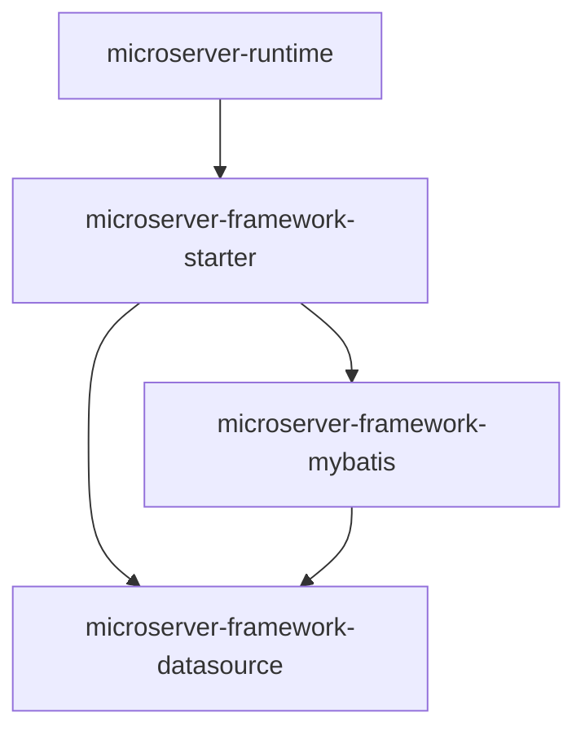

# 멀티프로젝트 구성 개념과 설계 원칙

## 1. 구성 목적

MicroServer는 공통 기술 기능을 제공하는 **Framework**와 업무 애플리케이션을 실행하는 **Runtime**을 분리한다. 업무 개발자는 Controller, Service, Domain, Repository/Mapper, DTO 구현에 집중하고, DataSource·트랜잭션·MyBatis 같은 공통 설정은 Framework가 제공한다.

여러 업무 애플리케이션이 같은 Framework를 사용할 수 있도록 공통 코드를 라이브러리로 만들고, Runtime은 필요한 라이브러리를 의존성으로 가져와 실행한다. 공통 기능을 수정할 때마다 업무 프로젝트에 소스를 복사하는 방식 대신, Framework 버전을 선택하여 적용하는 구조를 목표로 한다.

이 문서는 앞으로 만들 프로젝트의 역할과 의존성, 코드 배치 원칙을 정의한다. 실제 프로젝트 생성, Gradle 설정, 자동 구성 구현과 실행 검증은 후속 가이드에서 단계별로 진행한다. 아래 프로젝트 이름과 세부 분리는 최초 구성안이며, 생성 단계에서 확정한다.

## 2. 프로젝트·모듈·저장소의 구분

| 용어 | 의미 | MicroServer에서의 사용 |
| --- | --- | --- |
| Gradle 프로젝트 | 자체 빌드 설정과 작업을 가지는 빌드 단위 | DataSource 라이브러리, MyBatis 라이브러리, Runtime 등 |
| 모듈 | 역할을 기준으로 나눈 기능 단위 | 이 가이드에서는 각 Gradle 하위 프로젝트를 모듈이라고도 부른다. Java의 JPMS 모듈을 의미하지 않는다. |
| 멀티프로젝트 빌드 | 하나의 `settings.gradle`에서 여러 하위 프로젝트를 포함하여 빌드하는 구조 | Framework의 여러 공통 모듈을 함께 개발·검증한다. |
| Git 저장소 | 변경 이력과 소스 버전을 관리하는 단위 | Framework와 업무 Runtime의 소유권·릴리스 주기에 따라 분리한다. |
| VS Code Workspace | 여러 폴더를 함께 열어 편집하는 개발 작업 공간 | Framework, Runtime, 외부 리소스를 한 창에서 다룬다. |
| Composite Build | 독립적인 Gradle 빌드를 `includeBuild`로 연결하는 방식 | 별도 저장소의 Runtime과 Framework를 로컬에서 함께 검증할 때 활용할 수 있다. |

폴더를 VS Code에 함께 추가하는 것만으로 Gradle 의존성이 연결되지는 않는다. 빌드 연결은 `settings.gradle`과 의존성 선언에서 처리해야 한다. 또한 멀티프로젝트로 구성한다고 모든 프로젝트를 하나의 Git 저장소에서 관리해야 하는 것은 아니다.

## 3. Framework와 Runtime의 책임

### 3.1 Framework

Framework는 여러 업무에서 재사용하는 기술 기능과 표준 동작을 제공한다.

- Framework DB·Business DB의 DataSource와 트랜잭션 관리
- MyBatis의 SqlSessionFactory·SqlSessionTemplate 구성
- Framework 자체 기능에 필요한 Mapper와 SQL
- 공통 설정 속성과 기본 동작, 설정 오류에 대한 검증
- 향후 공통 Web·Security·Logging·예외 처리 기능

Framework는 특정 업무 Runtime의 클래스, 업무 테이블, DTO에 의존하지 않는다. 업무별로 달라지는 값은 외부 설정으로 받고, 특수한 동작은 명시적인 확장 지점에서 조정한다. 아직 구현하지 않은 공통 기능은 해당 기능을 개발하는 단계에서 프로젝트 분리 필요성을 판단한다.

### 3.2 Runtime

Runtime은 실행 가능한 Spring Boot 업무 애플리케이션이다. 여기서 Runtime은 JDK나 서버 실행 환경이 아니라 **애플리케이션 프로젝트의 역할**을 뜻한다.

- 애플리케이션 진입점과 기동 설정
- 업무 Controller·Service·Domain·Repository/Mapper·DTO
- 업무 Mapper 인터페이스와 SQL XML
- 업무 매퍼를 Business SqlSessionTemplate에 연결하는 등록 설정
- 실행 프로파일과 외부 설정 경로 지정
- Framework와 업무 기능을 함께 확인하는 통합 테스트

DataSource나 SqlSessionFactory의 구현을 Runtime마다 다시 작성하지 않는다. Runtime은 Framework가 제공하는 Bean과 설정 규약을 사용한다. 업무 매퍼의 패키지 등록은 업무 경계를 나타내는 최소 설정으로 관리하고, 공통 세션 생성 로직은 Framework에 둔다.

## 4. 최초 프로젝트 구성안

공통 프로젝트를 기능별로 나누고, Runtime이 필요한 공통 기능을 한 의존성으로 사용할 수 있도록 Starter를 둔다.

| 프로젝트 | 책임 | 산출물 | 실행 진입점 |
| --- | --- | --- | --- |
| `microserver-framework-datasource` | 두 DataSource, 설정 속성, 트랜잭션 관리자 | 일반 JAR | 없음 |
| `microserver-framework-mybatis` | 두 세션 구성, Framework 매퍼 등록, Framework 전용 Mapper·XML | 일반 JAR | 없음 |
| `microserver-framework-starter` | 공통 라이브러리 의존성을 묶어 Runtime의 도입 창구 제공 | 일반 JAR | 없음 |
| `microserver-runtime` | 업무 구현, 업무 매퍼 등록, 애플리케이션 기동 | 실행 가능한 Boot JAR | 있음 |

Starter는 공통 모듈의 의존성을 모아 제공하는 역할이다. 자동 구성 클래스는 실제 기능을 소유한 DataSource·MyBatis 프로젝트에 두는 방향으로 설계한다. Starter에 모든 기능 구현을 모으지 않는다.

현재 외부 리소스 폴더 `microserver_resource`는 환경별 설정을 관리하는 별도 영역으로 유지한다. Java 코드가 없으므로 공통 라이브러리와 같은 Gradle 하위 프로젝트로 취급할 필요는 없다.

### 의존성 방향

화살표는 왼쪽 프로젝트가 오른쪽 프로젝트를 사용한다는 뜻이다.

MyBatis 모듈은 DataSource 모듈이 제공하는 Bean과 등록 순서를 전제로 세션을 구성한다. 두 모듈 사이의 결합은 이 공개 계약으로 제한한다. DataSource 모듈에서 MyBatis 모듈을 참조하거나, Framework에서 Runtime을 참조하는 역방향 의존성은 만들지 않는다.

공통 모듈은 라이브러리이므로 애플리케이션 메인 클래스와 실행 가능한 Boot JAR이 필요하지 않다. 실행·배포의 단위는 Runtime이고, Runtime의 배포물에 필요한 공통 라이브러리가 포함된다. 공통 모듈을 각각 서버 프로세스로 실행하는 구조는 아니다.

## 5. 저장소와 로컬 개발 구조

Framework는 별도 저장소에서 공통 라이브러리로 관리·배포하고, Runtime은 사용할 Framework 버전을 선택하는 방향을 기준으로 한다.

| 영역 | 저장소 구성 방향 | 빌드 방식 |
| --- | --- | --- |
| Framework | `microserver-framework` 저장소 아래 DataSource·MyBatis·Starter 프로젝트 | 하나의 Gradle 멀티프로젝트 빌드 |
| Runtime | `microserver-runtime` 저장소 | 독립 Gradle 애플리케이션 빌드 |
| 외부 리소스 | 환경 설정을 관리하는 별도 저장소 | Runtime이 지정한 파일 경로에서 읽음 |

Framework의 루트 프로젝트는 공통 버전·빌드 규칙을 관리하고 하위 프로젝트를 포함하는 역할을 한다. 업무 코드는 하위 라이브러리나 Framework 루트에 두지 않는다.

배포된 Framework를 사용하는 Runtime은 `implementation '그룹:라이브러리:버전'` 형태의 라이브러리 의존성을 사용한다. Framework와 Runtime을 함께 수정하는 로컬 개발에서는 Composite Build로 해당 라이브러리 의존성을 로컬 Framework 프로젝트로 대체할 수 있다. 라이브러리 좌표가 일치하도록 구성하고, 필요하면 명시적인 치환 규칙을 지정한다.

`project(':...')`는 같은 멀티프로젝트 빌드 내부의 프로젝트 연결에 사용한다. 독립 빌드인 Runtime에서 다른 저장소의 Framework를 사용할 때는 라이브러리 의존성과 Composite Build를 구분하여 적용한다. 폴더가 이웃해 있다는 이유만으로 `project` 의존성을 사용할 수는 없다.

실제 구성 단계에서는 Framework 저장소 위치, Runtime 저장소 위치, 라이브러리 좌표와 버전, 로컬 연결 방법을 확정하고 가이드의 실행 경로를 일치시킨다.

## 6. 기존 DataSource·MyBatis 작업의 활용

앞선 가이드에서 구현한 두 DB 연결과 세션 구성을 공통 프로젝트의 출발점으로 사용한다. 구현 내용을 새로 복제하여 Runtime에도 남겨두는 대신, 책임에 맞는 프로젝트로 배치하고 등록 방법을 정리한다.

| 기존 구성 요소 | 배치할 프로젝트·영역 | 배치 원칙 |
| --- | --- | --- |
| DataSource 설정 속성 클래스 | Framework DataSource | 설정 키와 의미를 유지하고 공통에서 관리 |
| Framework·Business DataSource | Framework DataSource | 두 DB를 구분하여 생성 |
| Framework·Business TransactionManager | Framework DataSource | 각 DataSource와 일대일로 연결 |
| SqlSessionFactory·SqlSessionTemplate 구성 | Framework MyBatis | 두 DB별 세션 연결 유지 |
| Framework Mapper와 XML | Framework MyBatis | 공통 기능 소유 코드와 SQL을 같은 프로젝트에 배치 |
| Business Mapper와 XML | Runtime | 업무 코드와 함께 관리·배포 |
| Business Mapper 등록 설정 | Runtime | 업무 패키지를 Business Template에 연결 |
| 업무 Service와 트랜잭션 경계 | Runtime | 업무 단위로 트랜잭션을 선언 |
| `application.yml`과 실행 프로파일 지정 | Runtime | 애플리케이션 기동과 외부 설정 import 담당 |
| 환경별 DataSource·MyBatis YAML | 외부 리소스 | 접속 값과 환경별 설정 관리 |
| 공통 MyBatis 설정 XML | 외부 리소스의 기존 관리 위치 | 기존 설정 참조를 유지하고 배포 시 파일 제공 여부 확인 |
| DB·MyBatis 통합 검증 코드 | Runtime 통합 테스트부터 적용 | 공통 JAR과 Runtime의 실제 연결을 검증하고, 모듈 단위 테스트는 별도로 분리 |

공통 MyBatis 설정 XML과 SQL Mapper XML은 역할이 다르다. 전자는 MyBatis 옵션을 지정하고, 후자는 실행할 SQL을 정의한다. SQL Mapper XML은 해당 기능의 소유 프로젝트 리소스에 포함한다.

### 유지할 Bean 계약

| 구분 | Framework DB | Business DB |
| --- | --- | --- |
| DataSource | `frameworkDataSource` | `businessDataSource` |
| TransactionManager | `frameworkTransactionManager` | `businessTransactionManager` |
| SqlSessionFactory | `frameworkSqlSessionFactory` | `businessSqlSessionFactory` |
| SqlSessionTemplate | `frameworkSqlSessionTemplate` | `businessSqlSessionTemplate` |

프로젝트를 분리해도 Bean 이름과 DB 연결 관계는 유지하는 것을 기본으로 한다. `@Primary` 지정과 기존 외부 설정 키도 이관 과정에서 함께 확인한다. Bean 선택이 모호한 공통 구성에서는 `@Qualifier`로 연결 대상을 명확히 한다.

각 트랜잭션 관리자는 자신에게 연결된 DataSource의 로컬 트랜잭션을 관리한다. 두 DB를 사용한다는 사실만으로 하나의 트랜잭션에서 두 DB의 커밋·롤백이 원자적으로 보장되지는 않는다.

## 7. Framework 설정을 Runtime에 등록하는 원칙

JAR 의존성을 추가하는 것과 그 안의 설정을 Spring Bean으로 등록하는 것은 별개의 일이다. Framework 패키지가 Runtime 메인 클래스의 컴포넌트 스캔 범위에 우연히 포함되는 것에 의존하지 않는다.

공통 라이브러리는 Spring Boot 자동 구성 등록 방식을 사용하여 필요한 설정을 제공하는 방향으로 설계한다. 자동 구성 후보는 `META-INF/spring/org.springframework.boot.autoconfigure.AutoConfiguration.imports`에 등록하며, 기능별 클래스와 선행 Bean 조건에 따라 적용되도록 한다.

후속 구현에서는 다음 항목을 함께 다룬다.

1. DataSource가 등록된 뒤 해당 DB의 MyBatis 세션 구성이 처리되도록 순서를 지정한다.
2. 기존 설정 클래스를 광범위하게 스캔하여 자동 구성과 중복 등록하지 않는다.
3. 업무 Mapper 스캔은 Runtime에서 담당하고, Framework는 특정 업무 패키지를 고정하지 않는다.
4. 설정 재정의는 지원하는 지점과 Bean 이름을 명시한다. 무조건 Bean 덮어쓰기를 허용하는 방식은 사용하지 않는다.
5. 기존 MyBatis Starter 자동 구성 제외 정책과 공통 명시 구성을 함께 검토하여, 세션 Bean 중복을 방지한다.

이 단계에서 자동 구성 전환이 이미 끝났다고 가정하지 않는다. 기존 DataSource·MyBatis 로직을 재사용하되, 프로젝트 밖에서 제공되는 라이브러리로 동작하도록 등록 방식과 순서를 별도로 구현·검증해야 한다.

## 8. 업무 개발자가 사용하는 방식

업무 개발자는 Runtime에 표준 Starter를 추가하고, 실행 환경에 맞는 외부 설정을 연결한다. 이후 업무 Mapper와 SQL을 작성하고, Service에서 해당 Mapper를 호출한다.

| Framework 개발자의 책임 | 업무 개발자의 책임 |
| --- | --- |
| 공통 연결·세션·트랜잭션 구성 제공 | 사용할 Framework 버전 선택 |
| 설정 키와 기본 동작 정의 | 실행 프로파일·외부 설정 위치 지정 |
| 공통 Bean 계약과 확장 지점 제공 | 업무 Mapper 등록과 SQL 구현 |
| 공통 기능 테스트와 릴리스 | 업무 로직과 트랜잭션 경계 구현·테스트 |

예를 들어 업무 Service는 `businessSqlSessionFactory`를 직접 만들지 않고 Business Mapper를 주입받는다. DB 접속과 세션 생성은 공통에서 제공하며, 업무 Service는 처리할 업무와 트랜잭션 범위에 집중한다.

## 9. 후속 가이드 진행 순서

| 단계 | 작업 | 확인할 결과 |
| --- | --- | --- |
| 1 | Framework 루트와 공통 하위 프로젝트 생성 | Gradle에서 각 프로젝트 인식 |
| 2 | 신규 Runtime 생성 및 Framework 의존성 연결 | 독립 Runtime에서 공통 라이브러리 사용 |
| 3 | DataSource 구현 배치 및 등록 | 두 DataSource와 트랜잭션 관리자 연결 |
| 4 | MyBatis 구현·매퍼 배치 및 등록 | DB별 Factory·Template·Mapper 연결 |
| 5 | 외부 설정과 VS Code 실행 설정 연결 | 프로파일과 경로를 명시하여 기동 |
| 6 | 통합 테스트·패키징·실행 검증 | 두 DB의 SQL 실행, 트랜잭션 동작, Boot JAR 리소스 로딩 |
| 7 | 공통 JAR 배포 및 버전 사용 방식 정리 | 로컬 소스 연결과 배포 라이브러리 사용을 각각 검증 |

프로젝트 생성 가이드에는 Windows와 macOS의 경로 및 실행 명령 차이를 함께 정리한다. 검증 결과는 실제 실행 후 기록하며, 개념 문서의 설계안을 실행 완료 결과로 표현하지 않는다.

## 참고 문서

- [Gradle: Multi-Project Builds](https://docs.gradle.org/current/userguide/multi_project_builds.html)
- [Gradle: Composite Builds](https://docs.gradle.org/current/userguide/composite_builds.html)
- [Spring Boot: Creating Your Own Auto-configuration](https://docs.spring.io/spring-boot/reference/features/developing-auto-configuration.html)
