# 멀티프로젝트 프레임워크 구성

## 1. 멀티프로젝트란

Gradle의 멀티프로젝트(Multi-Project)는 하나의 Root Project 아래에 여러
개의 Sub Project를 구성하고, 각 프로젝트의 역할과 의존성을 분리하여
하나의 시스템을 개발하는 방식이다.

하나의 Spring Boot 프로젝트에 Framework 공통 기능, 업무 기능, 관리자
기능을 모두 구현할 수도 있다. 그러나 시스템이 커질수록 서로 다른 성격의
코드가 하나의 프로젝트에 섞이고, 특정 기능의 변경이 다른 영역에 영향을
주기 쉬워진다.

멀티프로젝트 구조에서는 역할이 다른 기능을 별도의 프로젝트로 분리하고
필요한 프로젝트만 의존하도록 구성한다. 이를 통해 **코드의 물리적인
위치뿐 아니라 책임과 의존성의 경계도 명확하게 관리**할 수 있다.

MicroServer는 다음 세 가지 책임을 분리하기 위해 멀티프로젝트 구조를
사용한다.

- **Framework**: 애플리케이션에서 반복적으로 필요한 공통 기술 기능
    제공
- **Runtime**: Framework를 사용하여 실제 도메인 업무 기능 구현
- **Admin**: Framework의 상태를 조회하고 운영·관리하는 독립
    애플리케이션

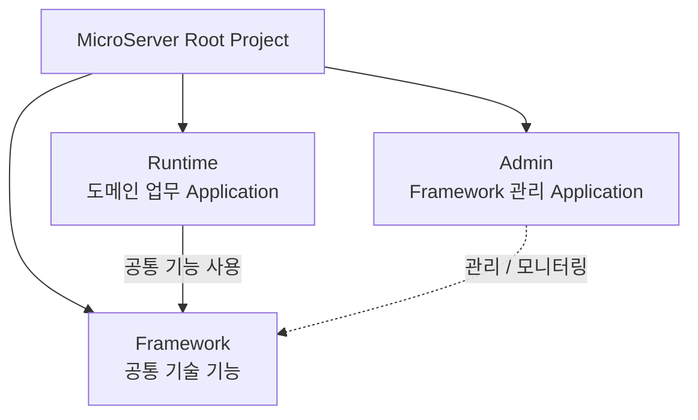

Root Project는 전체 프로젝트의 빌드와 공통 기준을 관리하고,
Framework·Runtime·Admin은 각자의 책임에 따라 독립된 Sub Project로
구성한다.

---

## 2. MicroServer 멀티프로젝트 구성 방향

MicroServer Framework의 핵심 목적은 **Runtime 개발자가 애플리케이션마다
반복되는 기술 기반을 직접 구성하지 않고 도메인 업무 개발에 집중할 수
있도록 하는 것**이다.

일반적인 Spring Boot 업무 애플리케이션을 개발하려면 업무 기능 외에도
Database 연결, Transaction, Data Access, 요청 전·후처리, 예외 처리,
Logging, 인증·인가와 같은 기반 기능이 필요하다.

이 기능들은 대부분의 Runtime에서 반복적으로 필요하고 구현 방식의
일관성도 중요하다. 따라서 MicroServer에서는 이러한 기술 기능을
Framework에서 표준화하여 제공하고 Runtime은 이를 사용한다.

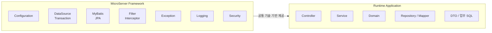

Framework가 업무 기능까지 구현하는 것은 아니다. Framework는 **업무
기능이 실행되기 위해 공통적으로 필요한 기술 기반과 표준 동작**을
제공하고, 실제 도메인 규칙과 업무 로직은 Runtime이 소유한다.

---

## 3. Framework 핵심 공통 기능

MicroServer Framework의 핵심은 **Runtime에서 반복적으로 구현되는 기술 기반을 Framework로 분리하여 표준화하는 것**이다.

아래 7개 기능을 Framework의 핵심 공통기능으로 구성한다. 이 기능들은 특정 업무 도메인에 종속되지 않고 대부분의 업무 애플리케이션에서 공통으로 필요하며, 서로 연계되어 Runtime의 실행 기반을 만든다.

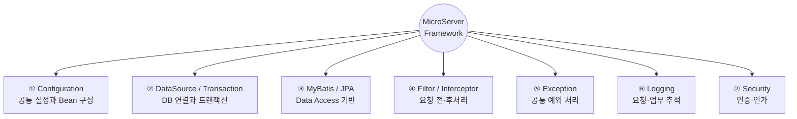

### 핵심 공통기능 한눈에 보기

#### ① Configuration — Framework 구성의 시작점

**Framework 기능의 설정, Bean 구성, Property와 기본 동작을 관리한다.**

DataSource, MyBatis, Security 등 각 Framework 기능이 동일한 설정 원칙으로 초기화되고 서로 연결될 수 있도록 하는 기반이다.

#### ② DataSource / Transaction — 데이터 처리 기반

**Database Connection과 Transaction을 Framework 표준 방식으로 구성한다.**

Runtime은 업무 Transaction의 범위를 결정하고, Connection Pool과 Transaction Manager 등의 기술 구성은 Framework가 담당한다.

#### ③ MyBatis / JPA — Data Access 기반

**Runtime이 업무 특성에 따라 MyBatis 또는 JPA를 사용할 수 있는 공통 실행 기반을 제공한다.**

Framework는 Data Access 기술의 설정과 연결을 담당하고, Mapper·SQL·Entity·Repository와 같은 업무 데이터 접근 코드는 Runtime이 담당한다.

#### ④ Filter / Interceptor — 공통 전처리·후처리

**Controller 전후에서 반복되는 요청 처리 로직을 업무 코드와 분리한다.**

공통 Header, Trace ID, 사용자 Context, 요청 Logging, 권한 확인 등 애플리케이션 전체에 적용되는 처리를 표준화한다.

#### ⑤ Exception — 공통 오류 처리

**시스템 Exception과 업무 Exception을 일관된 방식으로 분류하고 처리한다.**

Runtime은 업무 오류를 정의하고 발생시키며, Framework는 Exception Handler, 오류 코드, Logging, 표준 오류 Response를 담당한다.

#### ⑥ Logging — 요청과 업무 흐름 추적

**하나의 요청이 Controller, Service, Data Access를 거치는 전체 흐름을 추적할 수 있는 Logging 기반을 제공한다.**

Trace ID와 공통 Context를 이용하여 장애 분석과 운영 추적에 필요한 일관된 Log를 생성한다.

#### ⑦ Security — 인증과 인가

**사용자 또는 시스템의 신원을 확인하고, 요청한 기능을 수행할 권한이 있는지 판단하는 공통 보안 기반을 제공한다.**

Framework는 Spring Security 기반의 인증·인가 처리 구조를 제공하고, 실제 사용자 체계와 업무 권한 정책은 Runtime에서 확장한다.

!!! tip "Framework 핵심 원칙"
    **Framework는 기술 기반을 제공하고, Runtime은 도메인 업무를 구현한다.**

    Runtime 개발자가 DataSource 생성, Transaction Manager 구성, MyBatis/JPA 기반 설정, 공통 Filter, Exception Handler, Logging, Security 기반 구성을 반복해서 구현하지 않도록 하는 것이 핵심이다.

### 3.1 공통 Configuration

Spring Boot 애플리케이션에서는 DataSource, MyBatis, Security, Logging 등
각각의 기술 기능을 사용하기 위해 여러 Configuration과 Bean을 구성해야
한다.

Runtime마다 이러한 설정을 직접 작성하면 프로젝트별 설정 방식이 달라지고
동일한 Framework를 사용하면서도 서로 다른 동작을 하게 될 수 있다. 또한
업무 개발자가 Framework 내부 구성까지 이해해야 하는 문제가 생긴다.

따라서 **Framework 기능을 초기화하고 서로 연결하는 Configuration 자체를
Framework의 핵심 책임**으로 둔다.

Framework의 공통 Configuration은 다음 역할을 담당한다.

- Framework 공통 Bean 생성 및 연결
- Framework Property 정의와 바인딩
- 기능별 기본 설정값 제공
- Framework 기능 활성화 및 비활성화
- Runtime에서 전달한 설정값 적용
- 환경별 설정과 Framework 기능 연결

Runtime은 Framework 내부 Bean을 직접 조립하기보다 필요한 설정값을
제공한다.

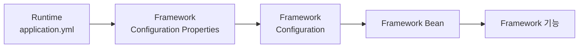

예를 들어 Runtime이 Database URL, 사용자 정보, Connection Pool 관련 값을
설정하면 Framework의 Configuration이 이를 읽어 DataSource와 Transaction
Manager를 구성하는 방식이다.

즉 **설정값은 Runtime이 제공할 수 있지만, 공통 기술 기능을 어떻게
구성하고 연결할 것인지는 Framework가 담당**한다.

---

### 3.2 DataSource 및 Transaction

Database 연결과 Transaction은 대부분의 업무 시스템에서 필수적인 기반
기능이다.

Runtime마다 DataSource 생성 방식과 Connection Pool 설정, Transaction
Manager 구성을 개별적으로 구현하면 동일한 Framework를 사용하는 프로젝트
사이에서도 Database 처리 방식이 달라질 수 있다.

따라서 Database에 접근하기 위한 기술 기반은 Framework에서 제공한다.

#### DataSource

DataSource는 애플리케이션이 Database Connection을 획득하고 관리하기 위한
기반 객체이다.

Framework에서는 다음 영역을 담당한다.

- DataSource 생성 및 초기화
- Database 연결 Property 처리
- Connection Pool 기본 설정
- DataSource 관련 공통 Bean 구성
- MyBatis / JPA와 DataSource 연결
- 향후 복수 DataSource 구성을 고려한 확장 기반

Database URL, 사용자 계정 등 환경마다 달라지는 실제 연결정보는 Runtime의
환경 설정에서 관리하고, 해당 정보를 이용하여 DataSource를 구성하는
방법은 Framework에서 제공한다.

#### Transaction

Transaction은 여러 Database 작업을 하나의 논리적인 작업 단위로 처리하여
데이터의 일관성을 유지하는 기능이다.

Framework에서는 다음 기능을 제공한다.

- Transaction Manager 구성
- DataSource와 Transaction Manager 연결
- Spring의 선언적 Transaction 사용 기반
- MyBatis / JPA와 Transaction 연계
- 공통 Transaction 처리 기준

Runtime의 Service는 업무적으로 Transaction이 필요한 범위를 정의하고,
실제 Transaction을 처리하기 위한 기반 구성은 Framework를 사용한다.

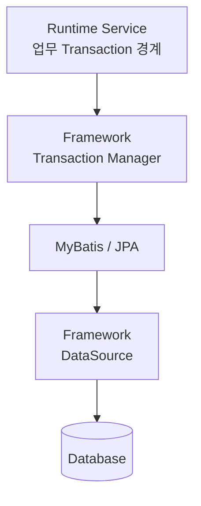

이렇게 역할을 분리하면 **Runtime은 어디까지 하나의 업무 Transaction으로
처리할지를 결정하고, Framework는 그 Transaction이 실제로 동작할 수 있는
기술 기반을 제공**한다.

---

### 3.3 Data Access - MyBatis / JPA

업무 애플리케이션은 Database에 저장된 데이터를 조회하고 변경하기 위한
Data Access 계층이 필요하다.

MicroServer는 프로젝트 성격에 따라 MyBatis 또는 JPA를 사용할 수 있도록
Framework에서 공통 기반을 제공한다.

Framework가 SQL이나 Entity 같은 업무 데이터를 소유하는 것은 아니다.
**Data Access 기술을 사용할 수 있도록 환경을 구성하는 것과 실제 업무
데이터 접근을 구현하는 것을 분리**하는 것이 핵심이다.

#### MyBatis

MyBatis는 SQL을 직접 작성하고 Mapper를 통해 Database 작업을 수행하는
Data Mapper Framework이다. 복잡한 SQL을 직접 제어해야 하는 업무
시스템에서 유용하다.

Framework에서는 다음 기능을 담당한다.

- MyBatis 공통 Configuration
- SqlSessionFactory 구성
- SqlSessionTemplate 구성
- Mapper Scan 기준
- MyBatis 공통 Property
- DataSource 연결
- Transaction 연계

Runtime에서는 다음 업무 영역을 구현한다.

- 업무 Mapper Interface
- Mapper XML
- 업무 SQL
- 업무 조회 및 저장 모델

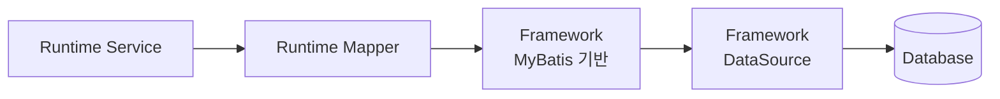

#### JPA

JPA는 Entity를 중심으로 객체와 관계형 Database 데이터를 매핑하여
처리하는 표준 Persistence API이다.

Framework에서는 JPA를 사용할 수 있도록 다음 기반을 제공한다.

- JPA 기본 Configuration
- EntityManager 기반 구성
- DataSource 연결
- Transaction 연계
- 공통 JPA Property
- Spring Data Repository 사용 기반

Entity와 업무 Repository, 도메인 관계는 Runtime이 구현한다.

MyBatis와 JPA 중 하나를 Framework가 강제하기보다 **Runtime의 업무 특성에
따라 적절한 Data Access 방식을 선택할 수 있도록 기반을 제공**하는
방향으로 구성한다.

---

### 3.4 Filter / Interceptor - 요청 전처리·후처리

Web 또는 API 애플리케이션에서는 Controller가 실행되기 전과 실행된 후에
공통으로 처리해야 하는 작업이 많다.

예를 들어 요청 식별번호 생성, 공통 Header 처리, 사용자 Context 설정,
요청 Logging, 권한 확인 등을 모든 Controller에서 반복하면 업무 코드와
기술 코드가 섞이게 된다.

이러한 공통 처리를 Framework의 Filter와 Interceptor에서 담당한다.

#### Filter

Filter는 Servlet 계층에서 HTTP Request와 Response를 처리한다. Spring
MVC의 Controller에 요청이 전달되기 전부터 동작하므로 애플리케이션 전체
요청에 적용해야 하는 공통 처리에 적합하다.

주요 적용 대상은 다음과 같다.

- Request / Response 공통 처리
- 공통 Header 처리
- 요청 식별정보 또는 Trace ID 생성
- 요청·응답 Logging 기반
- 공통 보안 전처리
- Character Encoding 등 Servlet 기반 처리

#### Interceptor

Interceptor는 Spring MVC의 Handler 실행 전후에 동작한다. 어떤
Controller가 실행되는지 알 수 있기 때문에 Controller 및 업무 호출과
밀접한 공통 처리에 적합하다.

주요 적용 대상은 다음과 같다.

- Controller 호출 전 공통 검증
- 사용자 및 요청 Context 처리
- 권한 확인
- 업무 호출 추적
- Controller 처리시간 측정
- Controller 실행 후 공통 처리

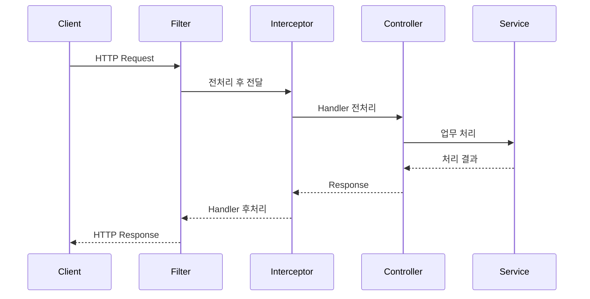

Filter와 Interceptor는 모두 전처리·후처리에 사용할 수 있지만 실행 계층과
목적이 다르다. Framework에서는 각각의 책임을 구분하여 공통 처리 기능이
중복되지 않도록 구성한다.

---

### 3.5 공통 Exception 처리

업무 처리 과정에서는 입력 오류, 업무 규칙 위반, Database 오류, 외부
시스템 오류 등 다양한 Exception이 발생한다.

각 Controller나 Service에서 `try-catch`를 반복하고 개별적으로 오류
Response를 생성하면 오류 처리 방식이 달라지고 업무 코드의 가독성도
떨어진다.

따라서 Exception의 최종 처리와 오류 Response 변환은 Framework에서
공통으로 담당한다.

Framework의 공통 Exception 기능은 다음을 제공한다.

- Framework 공통 Exception 체계
- 업무 Exception을 처리할 수 있는 기반
- Global Exception Handler
- 오류 코드 및 오류 메시지 처리
- 시스템 Exception과 업무 Exception 구분
- API 오류 Response 표준화
- Exception Logging 연계

Runtime에서는 업무 규칙에 따라 필요한 업무 Exception을 발생시킨다.
Framework는 전달된 Exception을 분석하여 Logging하고 표준 오류 형태로
변환한다.

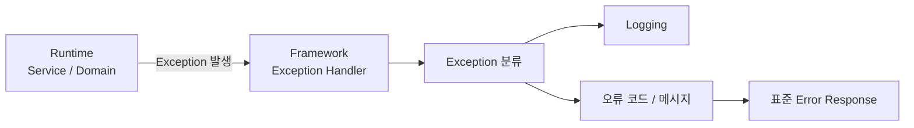

이 구조를 사용하면 업무 개발자는 오류 Response를 만드는 기술 처리보다
**어떤 상황이 업무 오류인지 정의하고 적절한 Exception을 발생시키는
것**에 집중할 수 있다.

---

### 3.6 Logging

Logging은 단순히 문자열을 파일에 출력하는 기능이 아니라 운영 중 발생한
요청과 업무 처리 과정을 추적하고 장애 원인을 분석하기 위한 핵심
기능이다.

특히 여러 계층을 거쳐 처리되는 Web/API 시스템에서는 하나의 요청이 어느
Controller와 Service를 거쳐 어떤 오류로 종료되었는지 연결해서 확인할 수
있어야 한다.

Framework에서는 애플리케이션 전체에 적용되는 Logging 기준과 공통 추적
기반을 제공한다.

주요 대상은 다음과 같다.

- Application Log
- HTTP 요청 / 응답 Log
- Exception Log
- Framework 내부 Log
- 사용자 및 요청 식별정보
- 처리시간
- Data Access 관련 Log
- 요청 단위 Trace 정보

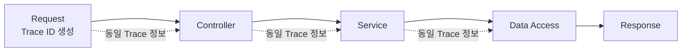

요청 단위 Trace ID와 공통 Context를 사용하면 Filter → Controller →
Service → Data Access로 이어지는 하나의 처리 흐름을 동일한 식별정보로
추적할 수 있다.

Runtime에서는 업무적으로 필요한 정보를 기록하고, Log 형식, 공통
식별정보, 요청 추적과 같은 기반은 Framework가 제공한다.

---

### 3.7 Security - 인증 / 인가

대부분의 업무 애플리케이션은 사용자가 누구인지 확인하고 해당 사용자가
요청한 기능을 수행할 권한이 있는지 판단해야 한다.

이를 각각 **인증(Authentication)**과 **인가(Authorization)**라고 한다.

보안 처리를 Runtime마다 개별 구현하면 인증정보 관리, 권한 확인 방식,
보안 예외 처리 등이 프로젝트마다 달라질 수 있으므로 Framework에서 공통
보안 기반을 제공한다.

#### 인증(Authentication)

인증은 요청한 사용자 또는 시스템의 신원을 확인하는 과정이다.

적용 가능한 방식은 다음과 같다.

- 사용자 로그인 인증
- Session 기반 인증
- Token 기반 인증
- API 인증
- 시스템 간 인증
- 인증정보 Security Context 관리

#### 인가(Authorization)

인가는 인증된 사용자 또는 시스템이 특정 기능을 수행할 권한이 있는지
판단하는 과정이다.

예를 들면 다음과 같다.

- URL 접근 권한
- API 접근 권한
- Role 기반 권한
- 기능별 권한
- 프로젝트별 업무 권한

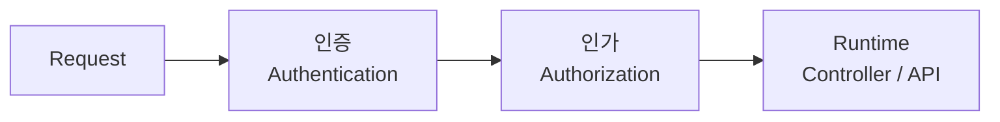

Framework에서는 Spring Security를 기반으로 인증·인가 처리 흐름, Security
Context, 공통 예외 처리 등 재사용 가능한 기반을 제공한다.

반면 실제 사용자 체계, 조직 및 권한 모델, 인증 수단처럼 프로젝트마다
달라지는 정책은 Runtime에서 정의하거나 Framework의 확장 지점을 이용한다.

즉 Framework가 모든 프로젝트의 보안 정책을 결정하는 것이 아니라 **보안
기능을 일관되게 구현할 수 있는 표준 기반을 제공**한다.

---

## 4. Runtime - 도메인 업무 개발

Runtime은 MicroServer Framework를 사용하는 실제 실행 애플리케이션이다.

은행 업무 시스템이 될 수도 있고, 증권 시스템, 일반 Web Application 또는
REST API Server가 될 수도 있다. 따라서 Framework는 특정 도메인을 전제로
하지 않으며 실제 업무 모델과 규칙은 Runtime에서 구현한다.

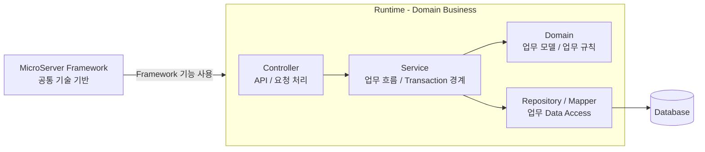

Runtime의 주요 개발 대상은 다음과 같다.

- 업무 Controller 및 API
- 업무 Service
- Domain Model과 업무 규칙
- DTO
- Repository / Mapper
- 업무 SQL
- 업무 Validation
- 업무 Exception
- 프로젝트 고유 Configuration
- 프로젝트 고유 Resource

Framework는 이러한 업무 코드를 대신 구현하지 않는다. Framework가 기술
기반을 제공함으로써 Runtime의 코드에서 DataSource 생성, Transaction
Manager 구성, 공통 Filter, Logging 설정, Security 기본 구성 등의
반복적인 기술 코드를 제거하는 것이 목적이다.

---

## 5. Admin - Framework 관리

Admin은 Runtime의 업무 관리자 화면과 구분되는 **MicroServer Framework
관리 애플리케이션**이다.

Framework의 상태를 확인하고 Framework가 제공하는 운영 기능을 제어하기
위한 독립 실행 애플리케이션으로 구성한다.

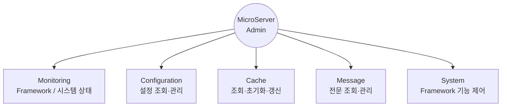

관리 기능의 예시는 다음과 같다.

- Framework 상태 및 시스템 모니터링
- Framework 설정 조회 및 관리
- Cache 상태 조회, 초기화 및 갱신
- 전문(Message) 정보 조회 및 관리
- Framework 공통 게시판 관리
- 시스템 및 Port 관련 설정 관리
- Framework 제공 기능의 상태 확인과 제어

Admin이 별도의 프로세스로 실행되는 Runtime을 관리하려면 Runtime 내부
상태를 직접 참조할 수 없으므로 관리 API 또는 별도의 관리 인터페이스가
필요하다.

따라서 Admin은 Framework의 관리 기능을 제공하되 Runtime 업무 코드와 직접
결합하지 않는 구조로 구성한다.

---

## 6. 기타 Framework 제공 기능

다음 기능들은 핵심 기반 기능 위에 선택적으로 추가할 수 있는 Framework
확장 기능이다.

### 6.1 Cache

반복적으로 조회되는 데이터의 성능을 개선하기 위해 Cache 공통 기능을
제공할 수 있다.

Framework에서는 Cache Manager 구성, Cache 생성·제거·갱신 등의 기반을
제공하고 Runtime에서는 어떤 업무 데이터를 Cache할 것인지 결정한다.

Admin과 연계하면 운영 중 Cache 상태 조회 또는 초기화 기능을 제공할 수
있다.

### 6.2 전문(Message) 처리

금융 시스템이나 외부 시스템 연계에서 사용하는 전문 처리 기능을
Framework로 제공할 수 있다.

공통 전문 Header, 전문 Format, Parsing, 송수신, 추적정보 및 오류 처리
등을 표준화하면 Runtime에서는 개별 업무 전문의 데이터와 처리 로직에
집중할 수 있다.

Admin에서는 전문 정의나 처리 상태 등을 관리하는 기능으로 확장할 수 있다.

### 6.3 Validation

Spring Bean Validation과 공통 Validator를 활용하여 입력값 검증 기반을
제공할 수 있다.

Framework는 Validation 실패 결과를 공통 Exception 처리와 연결하고
Runtime은 업무별 검증 규칙을 정의한다.

### 6.4 표준 Response

REST API에서 프로젝트 전체가 동일한 Response 구조를 사용해야 하는 경우
정상 응답, 오류 응답, 공통 Header, 오류 코드 등의 표준 형식을
Framework에서 제공할 수 있다.

### 6.5 AOP

AOP는 여러 업무 코드에 반복되는 횡단 관심사를 업무 로직과 분리하기 위해
사용한다.

업무 호출 추적, 처리시간 측정, 공통 Logging 또는 특정 Framework 기능
적용 등에 사용할 수 있다. 단, Filter나 Interceptor와 역할이 중복되지
않도록 적용 대상을 명확히 구분한다.

### 6.6 공통 Utility

날짜, 문자열, 변환 등 여러 Runtime에서 실제로 반복되는 범용 기능은
Framework Utility로 제공할 수 있다.

특정 업무에만 필요한 Utility는 이름이 공통처럼 보이더라도 Framework에
포함하지 않고 해당 Runtime이 소유한다.

---

## 7. 전체 구성 원칙

MicroServer 멀티프로젝트 Framework의 전체 책임은 다음과 같이 정리한다.

```mermaid
flowchart LR
    subgraph FW["Framework"]
        direction TB
        F1["Configuration"]
        F2["DataSource / Transaction"]
        F3["MyBatis / JPA"]
        F4["Filter / Interceptor"]
        F5["Exception"]
        F6["Logging"]
        F7["Security"]
    end

    subgraph RT["Runtime"]
        direction TB
        R1["Controller"]
        R2["Service / Domain"]
        R3["Repository / Mapper"]
    end

    subgraph AD["Admin"]
        direction TB
        A1["Monitoring"]
        A2["Framework 설정"]
        A3["Cache / 전문 관리"]
    end

    FW -->|"기술 기반 제공"| RT
    AD -.->|"운영 / 관리"| FW
```

Framework에는 특정 프로젝트의 도메인 업무를 포함하지 않는다.

Runtime에서는 Framework가 제공하는 기술 기능을 다시 구현하지 않고 도메인
업무 구현에 집중한다.

Admin은 Framework 운영과 관리에 집중하며 Runtime의 업무 관리자 기능과
구분한다.

이 책임 분리를 기준으로 Gradle 멀티프로젝트를 구성하고, Framework 기능이
커져 독립적인 책임 분리가 필요한 경우 Framework 내부를 추가 모듈로
확장한다.
